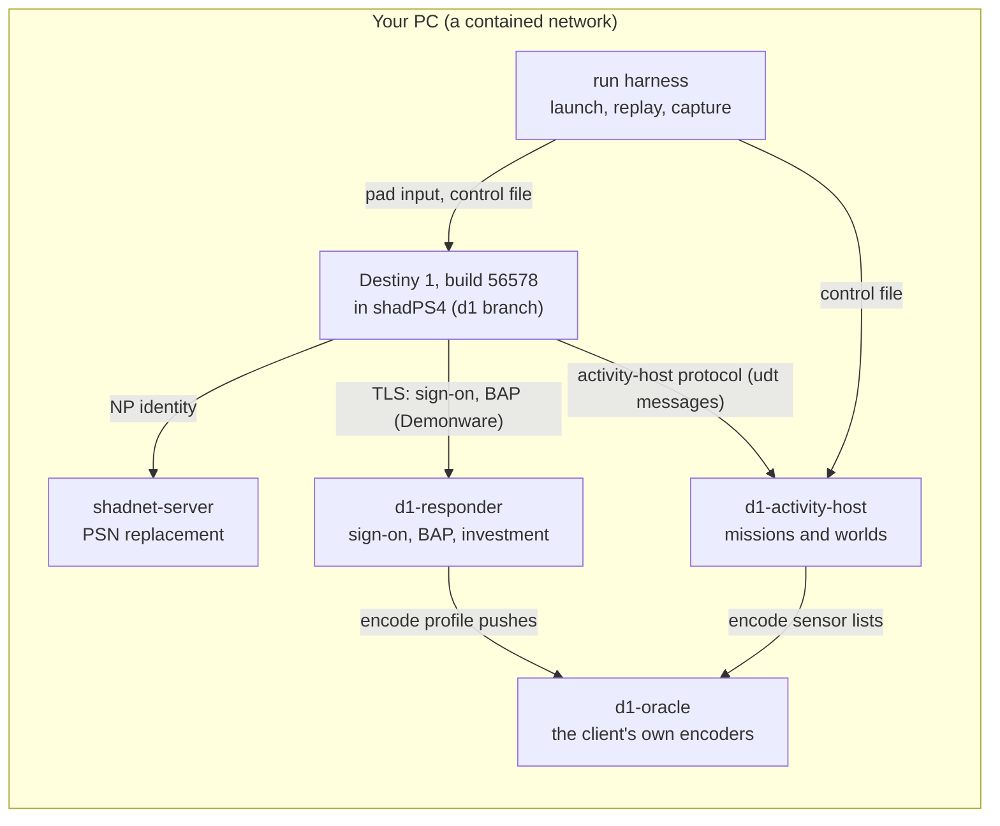

# How a run fits together

Destiny was built to talk to Bungie's servers, so on its own it stops at the title screen. This
project runs the original PS4 game (CUSA00219, executable build 56578) in an emulator and points it
at servers we wrote. Each one answers what the client asks, the way Bungie's did. Terms in *italics*
are explained in the [glossary](GLOSSARY.md).

## The pieces

| Piece | What it does | Where |
| --- | --- | --- |
| **The emulator** | Runs the game. The project's fork of shadPS4 adds fixes Destiny needs (texture cache, colour LUT, 60 Hz, PC mouse and keyboard). | [d1reimagined-shadps4](https://github.com/p3n1cillin/d1reimagined-shadps4), branch `d1` |
| **shadnet-server** | The *shadNet* server: the PSN replacement that gives the console an online identity. | [`crates/shadnet-server`](../ps4/d1-server/crates/shadnet-server), protocol in [`proto/`](../ps4/d1-server/proto) |
| **d1-responder** | Answers every endpoint the client calls: the PSN OAuth exchange and Bungie sign-on over TLS, and *BAP*, Bungie's service protocol (accounts, characters, *investment*: inventory, vendors, equipping). It logs every request, so a missing answer shows up in the log. | [`crates/d1-responder`](../ps4/d1-server/crates/d1-responder), wire format in [`crates/d1-bap`](../ps4/d1-server/crates/d1-bap) |
| **d1-activity-host** | Plays the part of Bungie's *activity host*, which runs a mission. It tells the client which world to load, then serves *sensor lists* (what exists and in what state) and steps the mission forward as the client reports back. | [`crates/d1-activity-host`](../ps4/d1-server/crates/d1-activity-host) |
| **d1-oracle** | Runs the client's own *RSAT* encoders offline (under the Unicorn CPU emulator), so what we send is byte-for-byte what the game would produce. The host and responder call it to build payloads. It needs your own copy of the executable. | [`crates/d1-oracle`](../ps4/d1-server/crates/d1-oracle) |
| **Run harness** | Starts the emulator and servers on a contained network, records evidence, and can play the first mission with nobody at the pad. | [`tools/ps4_setup`](../tools/ps4_setup) (`d1-agr-run.ps1`, `Start-D1ContainedBoot.ps1`), [`lab/tower-route`](../lab/tower-route/README.md) |
| **Analysis tools** | Package readers, static analysis of the executable, live-memory readers. | `d1-pkg`, `d1-eboot`, `d1-live`, `d1-scope`, [`tools/`](../tools) |

## How a mission is served

1. **Sign-on and characters.** The client signs on through the responder and asks for its account,
   characters and inventory. The answers are RSAT objects, delivered as *QueueZ* families
   ([`notes/investment-services.md`](../notes/investment-services.md)).
2. **The activity.** Launching A Guardian Rises (activity index 164) connects the client to the activity
   host. The host's *world table* says which world that is (`act_cosmo_m0_highway`) and how it starts
   ([`ps4/fixtures/56578/mission`](../ps4/fixtures/56578/mission)).
3. **Sensor lists.** The world is full of *sensors*: squads, triggers, doors, objectives. A sensor list
   names each one as `GROUP KIND INDEX has_a has_b [TAG HEX]`, and the last two fields give its state.
   For example:
   - a *squad* (kind `0x1`) with state `0x8080071E` has members to spawn;
   - a *trigger* (kind `0x1D`) with state `0x80800463` is armed.
4. **The schedule.** A *mission step* schedule
   ([`agr-steps-divide.txt`](../ps4/fixtures/56578/mission/agr-steps-divide.txt)) says which list to serve
   next and when. A step can wait for time, an *incident*, a *slice set*, a player *trigger*, or a squad
   cohort being cleared (`StepWhen` in
   [`state.rs`](../ps4/d1-server/crates/d1-activity-host/src/state.rs)).
5. **The client reports back** with *udt* messages:
   - incidents (udt 18, e.g. a cinematic stopped, or a trigger crossed);
   - the current slice set (udt 21);
   - squad sense updates (udt 6), which show who is alive.

   Those reports move the schedule on.
6. **Control.** While a run is going, the harness can hand the host a new list or incident through a
   control file (`D1_AH_CONTROL_FILE`). That is how the unattended route serves waves of Fallen.

What a run looked like, step by step, is in the dated [notes](../notes/README.md). The newest notes
are the most accurate.

## Tests and inputs

- **No game files needed** for most tests:
  - the Python suites in `server/`, `scripts/`, `tests/` and `tools/content_capture/`;
  - the Rust workspace in `ps4/d1-server`.

  [`tools/check.py`](../tools/check.py) runs what CI runs.
- **Your own inputs needed** for the tests that use the executable (`D1_EBOOT`) and for anything native.
  Those tests skip without their inputs, in CI as on your machine. Unit tests never prove in-game
  behaviour; a run does.
