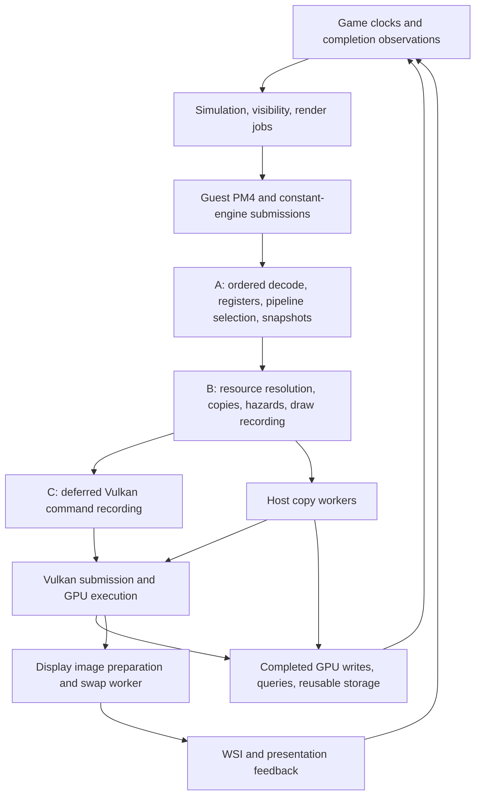

# Renderer flow, 10,000 draws, and the shadPS4 port decision

2026-10-05. Research and adversarial implementation handoff for Claude after compaction.

**There is no established 10,000-draw ceiling, and no evidence that 40–50 FPS is an inherent limit of Destiny. The task is to explain the entire dependency chain, then remove repeated translation work while preserving the guest's memory and completion contracts. “Port the command processor” is too imprecise to be an implementation instruction.**

The operator reports that Moosh's Xbox One compatibility layer has exceeded 100 FPS in actual gameplay. Carry that observation forward. The archived measurements I independently found cover orbit and menus; their narrower coverage does not contradict the operator's gameplay report. They establish specific implementation lessons, not the maximum achievement of the Xbox project.

This extends [the adversarial plan review](D:/dev/d1-preservation/docs/operations/native-client-20261004/ADVERSARIAL-PLAN-TO-60-20261005.md). Read that review for the detailed CE-counter, label-release, presentation, and occlusion findings. This document concentrates on the full rendering architecture and what a correct donor integration entails.

## 1. Conclusions that should change the plan

1. **Keep 60 and higher as credible engineering targets.** Replace any assertion that the renderer is already exonerated with an unresolved dependency question. Neither draw count nor average core utilization proves the answer.
2. **The fork's active fast path is predominantly CPU preparation plus host-generated multi-draw sequences.** Its default path does not run the compute resolver and does not call device-generated commands. Its “GPU command processor” name, introductory class comment, and older design documents obscure that distinction.
3. **Do not import the retired DGC executor.** Its source acknowledges an execution-set state problem; the Vulkan specification independently confirms the relevant restriction. It also contains explicit draw-dropping paths.
4. **Treat memory, shader ABI, resource caches, and ordered execution as one dependency set.** Copying only `vk_gpu_cp.cpp` or `FlushGpuRuns` cannot reproduce the fast path correctly. Copying the whole fork without examining those contracts merely imports its unresolved defects.
5. **Exploit the thinner runtime through explicit contracts.** Expose canonical backing identity, mapping generations, observed writes, and honest completion. These can make translation cheaper. Removing the emulator shell does not itself remove GCN shader translation, resource reconstruction, tiling, or synchronization.
6. **Use Xbox as an architectural comparator now.** Its completion-history repair, elapsed-time scheduling, deferred command lists, constant batching, and dirty-binding fast paths are concrete leads. Do not wait for an exact Xbox/PS4 benchmark match before learning from them.

No game was started, stopped, patched, or driven for this research. SSH access to the operator's Linux box was read-only. Selected reports and timing headers were copied into this workspace so this handoff survives compaction. There are no new performance measurements from this turn.

## 2. What was actually inspected

| Tree | Identity and scope |
| --- | --- |
| Native PS4 runtime | `D:/dev/d1-preservation/d1port`, HEAD `5224a6d137d8c4efaab69f2412f4bb86227b9ab8`, with the existing local patch series. Reviewed live source, not just its pinned commit. |
| Donor shadPS4 fork | `D:/dev/shadPS4`, HEAD `858862d75685b6133dc1683faf036ef46c84a855`. Reviewed command/range processing, shader draw indexing, resource versioning, imported memory, Linux write tracking, and source defaults. |
| Xbox local inventory | `D:/dev/d1-xbox`, particularly the binary comparison and earlier tester bundle inventory. |
| Xbox current source on the seat | `$HOME/dev/d1-xbox-moosh/src-main` resolves to `src-main-zip/d1-render-core-integration-main`. This is an extracted source snapshot; no Git revision is asserted. It contains `m0`, patched `dxvk`, `render_core`, and implementation reports. |
| Online primary material | Bungie's GDC renderer presentation, Khronos Vulkan specification/samples, AMD and NVIDIA guidance, DXVK developer documentation, Linux kernel memory documentation, and Mesa tracing documentation. Links accompany the relevant claims. |

Source findings below establish control flow and possible failure cases. They do not establish how often a case occurs during the operator's mission. Historical performance reports remain historical, with their hardware and configuration attached.

## 3. What the Xbox result tells us

### 3.1 The evidence is stronger than “the game was designed for 30”

The Xbox [uncapping report](D:/dev/d1-preservation/artifacts/renderer-research-20261005/xbox/uncapping-and-clocks.md) documents a corrected-time orbit run at 353.27 FPS, about 290 draws/frame, and game time advancing at 0.99765 times wall time. It distinguishes earlier, invalid fast-animation results from the corrected run.

The later [1080p report](D:/dev/d1-preservation/artifacts/renderer-research-20261005/xbox/uncapped-1080p.md) reports 313.2 FPS in settled orbit, 3.193 ms mean Present interval, 2.706 ms of GPU command ranges, and 3.920 ms p99 Present interval. Its separate short unprofiled check was 279.5 FPS. The [internal-4K report](D:/dev/d1-preservation/artifacts/renderer-research-20261005/xbox/uncapped-4k.md) reports 141.84 FPS, 7.05 ms mean and 8.44 ms p99 Present interval, on a Ryzen 7 9800X3D and RTX 3080. That test downsampled the 4K scene into a 1080p output window. These are rendering-production measurements, not scanout measurements.

Those captures retained approximately 30 simulation ticks/second. Newer source separately implements 60 Hz simulation: [kx_simulation.h](D:/dev/d1-preservation/artifacts/renderer-research-20261005/xbox/kx_simulation.h) changes the scheduler configuration, game-options rate, fixed-step frequency/period, and bounded catch-up allowance together. It explicitly provides no render-snapshot interpolation. Do not attribute the older high-FPS captures to that newer 60 Hz change.

The operator additionally reports **over 100 FPS in actual gameplay**. That is relevant positive evidence for the intended target. The exact scene, device, settings, and build for that result were not established in this inspection. The next comparable capture should record those variables; it should not spend effort trying to disprove the reported result through an older orbit-only report.

### 3.2 The useful Xbox lesson is a repaired flow

The Xbox uncapping work did more than change a number:

- It repaired the frame-statistics ABI. A timestamp had been written where the game expected an opaque completion cookie. The game could become stuck despite rapid presentation calls.
- It separated pending submissions from completed history and used DXVK's host-observed completion callback. It removed an assumed one-millisecond completion delay and a fabricated future refresh grid.
- It bypassed the render deadline while retaining job/dependency readiness checks.
- It disabled a fixed-per-render game-time override so the title's existing elapsed-time accumulator could emit simulation ticks independently.
- It preserved fractional UI milliseconds; truncation per render became visible at very high frame rates.

**PS4 next step:** map the equivalent *contracts*, rather than transplanting Xbox addresses or assuming matching structures. Trace which PS4 completion, flip, label, and clock values the outer loop reads; establish the event each value actually represents. The native plan's late-frame symptom is compatible with a bad completion contract as well as an expensive renderer. The Xbox history supplies a concrete precedent, not proof of the PS4 cause.

### 3.3 Xbox begins with more rendering information

The [local binary comparison](D:/dev/d1-xbox/XBOX-VS-PS4-BINARY-20260912.md) identifies Xbox D3D11X resource interfaces and PS4 GNM/PM4 interfaces. Xbox exposes resource creation, views, binding, map/update operations, and deferred command lists. PS4 hands the runtime registers, shader machine code, addresses, and synchronization packets from which much of that structure must be reconstructed.

This advantage is qualified: Xbox placement textures and direct producer writes still require coherence work. Its source contains write-watch handling and late constant-source capture. “D3D11 resources are explicit” does not mean “every producer write is intercepted by Map/Unmap.”

In the seat's patched DXVK, `src/d3d11/d3d11_context.cpp:3558` and `:3585` batch consecutive draws with unchanged state into command-stream data. Dirty bindings and the Xbox depth-feedback barrier are handled before batching. That is a useful design comparison with our per-draw pipeline. It does not imply that every such batch becomes exactly one Vulkan call on every device; the backend selects the emission path.

Two Xbox optimizations are particularly transferable as ideas:

| Xbox mechanism | Evidence | PS4 application and next step |
| --- | --- | --- |
| Batched small constant uploads | [Report](D:/dev/d1-preservation/artifacts/renderer-research-20261005/xbox/batched-constants.md): append-only per-context pages, late source reads, preserved sparse bindings, explicit lifetime and fallback. Synthetic CPU gains; no game-FPS gain claimed for that experiment. | Census constant sizes and versions, then aggregate immutable small snapshots into an append-only allocation. Preserve draw-time contents and retirement. Do not batch by rereading the guest ring later. |
| Cheap unchanged resource binds | [Report](D:/dev/d1-preservation/artifacts/renderer-research-20261005/xbox/srv-optimization.md): cached settings, owned immutable wrapper metadata, fewer global-lock/probe operations, dirty-source checks retained. | Separate immutable shader/layout facts from mutable resource contents and mappings. Count hit cost, not only miss rate. Keep required dirty checks on the fast path until a proven version protocol replaces them. |
| Demand-driven upload and retained versions | `render_core/README.md` documents immutable versions, consumer-specific uploads, and fence-retired storage. Some facilities are architectural prototype features. | Distinguish code linked into production from demonstrations before claiming a benefit. Transfer ownership principles first; measure real upload bytes and blocking. |

The builds also differ: the inspected Xbox binary is an April 2017 engine build; the PS4 target is the September 2016 v1.29 build. Compare pass structure and workload rather than equating draw counters across binaries.

## 4. The full renderer flow we need to optimize



The lower arrows back to the game are part of renderer performance. A guest thread can sleep because the renderer has not released a resource or reported completion. A command processor with no ready input can therefore be downstream-limited.

Bungie's own [2015 renderer presentation](https://advances.realtimerendering.com/destiny/gdc_2015/Tatarchuk_GDC_2015__Destiny_Renderer_web.pdf), especially PDF pages 195–215, emphasizes parallel command generation, ordered flushing, submission timing, and job granularity. It describes grouping work to avoid excessive job overhead while feeding the GPU promptly. Its platform-specific scheduling is evidence against treating one utilization percentage as the whole engine's budget. **Our inference:** adding translation stages can lose the original engine's intended overlap even when each stage appears individually affordable.

### 4.1 What the current native stages actually do

- [Draw](D:/dev/d1-preservation/d1port/gpu/shadps4/video_core/renderer_vulkan/vk_rasterizer.cpp:930) performs pipeline selection on stage A, then posts the draw when the pipeline is enabled.
- [PostDraw](D:/dev/d1-preservation/d1port/gpu/shadps4/video_core/renderer_vulkan/vk_rasterizer.cpp:575) packages register deltas, pipeline/preparation pointers, user data, flattened resource descriptors, and constant-ring bindings.
- [RunDrawPacket](D:/dev/d1-preservation/d1port/gpu/shadps4/video_core/renderer_vulkan/vk_rasterizer.cpp:718) reconstructs stage B's register state and installs the captured descriptor/user-data views.
- [DrawRecord](D:/dev/d1-preservation/d1port/gpu/shadps4/video_core/renderer_vulkan/vk_rasterizer.cpp:967) resolves resources and vertex/index inputs, prepares attachments, handles barriers, and records drawing.
- [SubmitExecution](D:/dev/d1-preservation/d1port/gpu/shadps4/video_core/renderer_vulkan/vk_scheduler.cpp:383) ends rendering, synchronizes deferred recording, waits for host copies, and submits. These are concrete serialization points.

Three threads are not three independent frame renderers. They form a pipeline whose overlap is repeatedly constrained by ordering, resource lifetime, and completion. Optimizing one stage can expose the next; adding workers can add queue handoffs and memory traffic without changing the critical dependency.

**Next step:** instrument stage queue occupancy and the reason for every substantial drain. Split running service from queue-full waits, empty-input waits, lock waits, and downstream completion. A name such as “GPU idle” in a profiler string is not an attribution proof.

### 4.2 What escaping the emulator's generality can buy us

On x86-64, shadPS4 already executes guest CPU code natively; its own [architecture documentation](https://github.com/shadps4-emu/shadPS4/wiki/VI.-Emulator-Design-%5BDevs%5D) distinguishes that from PM4 and GPU translation. Moving into bbport therefore does not automatically remove a CPU instruction translator. It does give us a smaller, title-specific place to fix runtime behavior and expose stronger information to the renderer.

There are three useful intervention levels:

| Boundary | Opportunity | Concrete next step |
| --- | --- | --- |
| Current PM4 boundary, improved native services | Preserve broad packet coverage while making physical identity, immutable constants, completion, and cached state cheap | Implement the measured adapter/ownership improvements described below. This is the first practical lane. |
| Earlier, title-specific render-submit boundary | Observe resource/view/material or submission-job information before it is flattened into registers and PM4 | Identify one stable submit routine and record its inputs alongside the existing PM4 result. Demonstrate an equivalent immutable draw description in shadow mode before bypassing that routine. |
| Replacement of a larger title renderer/backend | Potentially avoid most PM4 reconstruction and recover explicit resources similar to Xbox | Treat as a separate reverse-engineering project with shader, resource, pass, and feedback coverage. Cost it against the coherent donor-backend option after measuring the current bottleneck. |

Merely intercepting GNM entry points cannot be assumed to recover a high-level frame graph: the title can construct command data directly. Likewise, DXVK cannot directly consume a PS4 PM4 stream; introducing a fabricated D3D11 layer would still require reconstructing its resource and shader contracts. The promising title-specific shortcut is an **earlier verified semantic boundary**, not another API wrapper around the same unknown state.

This higher interception option belongs in the plan because the operator explicitly wants to exploit the native runtime's freedom. Keep it as a bounded research lane: one pass, one input contract, comparison against existing output, then decide whether it removes enough work to expand. It should not delay fixing measurable duplication and waits in the current path.

## 5. What 10,000 draws does and does not mean

### 5.1 Use arithmetic before architecture slogans

| Workload | Draws/second at 60 | Entire 16.667 ms budget divided by draws | A 13 ms stage budget divided by draws |
| --- | ---: | ---: | ---: |
| 10,000/frame | 600,000 | 1.667 µs | 1.300 µs |
| 10,400/frame | 624,000 | 1.603 µs | 1.250 µs |
| 13,300/frame | 798,000 | 1.253 µs | 0.977 µs |

These are arithmetic allowances, not measured hardware limits. Each allowance must also accommodate that stage's non-draw work. At 10,400 draws, saving 0.1 µs per draw saves 1.04 ms of that stage's service/frame. The equivalent at 13,300 draws is 1.33 ms.

With perfectly independent pipeline stages, steady-state throughput is constrained by the slowest stage. Real fences and backpressure add dependencies. Do not sum three 14 ms service estimates and call it 42 ms latency; do not take their maximum and declare proven 71 FPS either. A thread at 60% utilization while producing 45 frames/second has about 13.3 ms scheduled time/frame, which can include spinning and says nothing by itself about the late-frame tail.

The plan's 1.5–1.7 µs/draw and its utilization-derived estimates may use different brackets. Before comparing either with this table, write down numerator, denominator, sampling interval, included waits, and whether non-draw work is included.

### 5.2 The draw count is a multiplier for repeated work

One guest draw may cause register updates, shader lookup/specialization, pointer chasing, descriptor classification, several bindings, buffer bounds checks, cache synchronization, attachment work, barriers, staging copies, and several Vulkan calls. With 10,000 draws, tiny repeated costs become milliseconds. Conversely, a draw can be a tiny UI primitive or a large full-screen lighting pass. Equal counts do not imply equal GPU work.

Record these quantities per frame and pass:

| Layer | Minimum useful census |
| --- | --- |
| Guest production | Graphics/compute submissions, PM4 packets and bytes, direct/indirect draws, dispatches, CE dumps/bytes, waits, labels, nested IBs. |
| State preparation | Shader specializations checked/changed, pipeline lookups/misses/compiles, descriptor walks and bytes, memo hit and miss cost, register blocks captured. |
| Resource handling | Upload and snapshot bytes, copy count, dirty-page work, alias lookups, allocations/evictions, GPU-to-guest writes, blocked ownership transitions. |
| Host recording | Vulkan draw calls versus logical draws, run-length distribution, pipeline/descriptor/index binds, dynamic setters, rendering-scope ends, barriers by cause, submissions. |
| GPU | Queue gaps, draw/dispatch/pass timing, bandwidth/cache pressure, shader occupancy/register spills where supported, query/copy work, attachment transitions. |
| Feedback | Guest label/flip timing, frame-pool occupancy, acquired images, host presents/results, distinct displayed frames where measurable. |

A batch turning 10,000 guest draws into 2,000 host multi-draw calls still executes 10,000 logical draws. It can remove CPU recording and binding work; it does not remove their vertices, pixels, bandwidth, or legitimate synchronization. Khronos' [multi-draw sample](https://docs.vulkan.org/samples/latest/samples/performance/multi_draw_indirect/README.html) illustrates how shared geometry storage and indexed resource arrays reduce per-object bindings. The relevant opportunity here is amortizing state establishment and avoiding repeated reconstruction.

### 5.3 Four different changes are often confused

| Change | What it saves | What it does not establish |
| --- | --- | --- |
| Cache a prepared stage/resource version | Re-reading, hashing, classifying, and resolving unchanged inputs | That missed writes or aliases are harmless |
| Batch adjacent compatible draws | Per-run CPU/driver state setup and command emission | That arbitrary draw reordering is correct |
| Record independent work in parallel | Wall time on CPU recording's critical path | That shared caches/registers may be accessed concurrently |
| Use GPU generation or DGC | Some host generation/emission work | Lower total frame time when compute, preprocessing, barriers, and memory traffic are added |

Treat each as a separate experiment. Vendor advice supports batching and suitable parallel recording, but does not supply a universal draw limit. AMD also warns about small command buffers and state/barrier costs; NVIDIA explicitly describes the latency tradeoff from over-batching submissions. Neither says to collect a whole frame before giving the GPU useful work. [AMD RDNA guide](https://gpuopen.com/learn/rdna-performance-guide/), [NVIDIA Vulkan guidance](https://developer.nvidia.com/blog/vulkan-dos-donts/).

## 6. What our donor command processor really is

### 6.1 The effective default path

Read [vk_gpu_cp.cpp](D:/dev/shadPS4/src/video_core/renderer_vulkan/vk_gpu_cp.cpp:40) and [DispatchRange](D:/dev/shadPS4/src/video_core/renderer_vulkan/vk_gpu_cp.cpp:772):

| Setting/branch | Effective behavior |
| --- | --- |
| `SHADPS4_D1_GPU_CP=1` | Requests the subsystem, subject to its capability/configuration gates. It is otherwise off. |
| Executor unset or not `dgc` | Run executor. Host binds pipelines per run. |
| Host-sequence setting unset | Enabled with the run executor. CPU completes stage blocks and writes indirect arguments. |
| Host sequences enabled | `DispatchRange` increments statistics and returns. No compute-resolver dispatch, GPU table publication, or resolver barrier in that function. |
| Unified executor enabled, its default with host sequences | Eligible ranges use runs without requiring prior-frame prediction or a minimum-length threshold. Refused draws have an ordered classic fallback. |
| `FlushGpuRuns` | Commits dynamic-state changes, binds resources/pipeline/index storage per run, then calls `drawIndexedIndirect` with the run's draw count. |

[FlushGpuRuns](D:/dev/shadPS4/src/video_core/renderer_vulkan/vk_rasterizer_gpu_cp.cpp:2888) is the actual host-emission endpoint. The PM4 parser remains on the CPU. GPU vertex/pixel work remains shader work. The default path's advantage is primarily less repeated CPU preparation and fewer host bindings/calls, with a shader ABI that selects per-draw data.

**Documentation repair:** describe this as “versioned draw preparation and multi-draw execution.” Keep source setting names for compatibility, but print resolved executor, host/compute preparation, memory mode, sort mode, and fallback counters at startup. A counter named `gpu_draws` does not prove the GPU generated the commands.

### 6.2 Why a two-file transplant fails

The path relies on:

1. Ordered register/hash updates and CE/WRITE_DATA/DMA notifications from Liverpool.
2. Prepared stage versions and run memoization.
3. A shared draw/stage-block layout between host C++ and translated shaders.
4. Bindless image/sampler slots with correct keying and retirement.
5. Guest-address translation/BDA or suitable stable backing bindings.
6. Buffer/image coherence, pending-copy handling, and mapping generations.
7. Complete attachment compatibility and ordered range-closing hooks.
8. Index representation and correct draw/instance/vertex identity.
9. GPU completion-based ring reuse, including fallback and exhaustion behavior.

The initialization explicitly disables GPU CP when the fork's parallel recorder is enabled, because that recorder bypasses range boundaries: [source](D:/dev/shadPS4/src/video_core/renderer_vulkan/vk_rasterizer_gpu_cp.cpp:185). This is direct evidence against turning it on inside native A/B/C and assuming the concurrency models compose.

**Next step:** make an ownership map before porting. For each register view, stage version, cache, descriptor slot, command buffer, and guest write notification, assign one mutable owner and one ordered handoff. Initial integration should preserve a single owner for the donor's coupled mutable state. Parallelize preparation only after inputs are immutable and cache/publication ownership is explicit.

### 6.3 The retired DGC branch should stay retired

The source comment at [Requested](D:/dev/shadPS4/src/video_core/renderer_vulkan/vk_gpu_cp.cpp:42) calls out an execution-set problem. [AddPipeline](D:/dev/shadPS4/src/video_core/renderer_vulkan/vk_gpu_cp.cpp:378) creates one set from the initial pipeline, then adds subsequent pipelines. The current Vulkan requirement `VUID-vkUpdateIndirectExecutionSetPipelineEXT-None-11040` requires matching static/dynamic state definitions within that set; other requirements constrain layout and fragment interfaces. [Specification](https://docs.vulkan.org/refpages/latest/refpages/source/vkUpdateIndirectExecutionSetPipelineEXT.html).

There are also explicit failure modes in the old path:

- [CloseRange](D:/dev/shadPS4/src/video_core/renderer_vulkan/vk_rasterizer_gpu_cp.cpp:527) counts draws as dropped when no execution set exists yet.
- [ExecuteRange](D:/dev/shadPS4/src/video_core/renderer_vulkan/vk_gpu_cp.cpp:835) returns when preprocessing storage is exhausted, with a warning that ranges are dropped.
- The non-unified refusal path can produce a null sequence and count a dropped draw.

**Repair if DGC is ever reconsidered:** partition execution sets by full legal compatibility, validate every inserted pipeline, provide bounded preprocessing storage, and arrange same-frame ordered fallback before losing command provenance. First demonstrate that host multi-draw emission remains a measured bottleneck. The existence of a Vulkan extension is not a reason to accept a cold-frame rendering omission.

## 7. Correctness requirements for the useful fast path

### 7.1 Capture state at its semantic consumption point

The existing native pipeline already copies user data and flattened descriptors into its draw packet. Preserve that achievement. A later worker following a pointer into a CE ring can observe the next tenant of the same address. A pointer and a pipeline handle are not a snapshot.

The donor [stage-version path](D:/dev/shadPS4/src/video_core/renderer_vulkan/vk_rasterizer_gpu_cp.cpp:1580) tries to avoid rediscovery by retaining the exact ranges it read and invalidating affected paths when writers are observed. That is the right kind of optimization, provided its observation protocol is complete. “Unchanged address” and “same shader” are insufficient keys.

**Implementation contract:** captured bytes or retained content versions belong to a particular command/submission epoch. They remain usable through their last consumer. Mapping identity, content identity, shader specialization, and descriptor/view identity are separate dimensions. A GPU-written resource must have the correct producer-to-consumer dependency; increasing a CPU-side version counter does not make its bytes ready for a CPU read.

**Test:** two draws reuse the same CE-ring address with different constants while stage B is deliberately delayed. Each draw must consume its own version. Repeat with WRITE_DATA, DMA, nested IBs, a mapped alias, and a GPU-written descriptor/source. Inspect values, not merely final average image brightness.

### 7.2 Linux write tracking has a concrete race

In the fork, [QuerySoftDirty](D:/dev/shadPS4/src/core/d1_write_watch.cpp:113) reads `/proc/self/pagemap`; [ResetSoftDirty](D:/dev/shadPS4/src/core/d1_write_watch.cpp:164) separately writes `4` to `/proc/self/clear_refs`; [QuerySpans](D:/dev/shadPS4/src/core/d1_write_watch.cpp:234) performs the reset after scanning all spans.

Counterexample:

1. The sweep reads page P as clean.
2. A guest producer writes P.
3. The sweep clears process-wide soft-dirty state.
4. Neither that sweep nor the next reports the write to P.

The registry's shared lock protects registry structure; it does not stop the guest store. Reset errors/short writes also do not propagate from that function as a failed sweep. Submission coverage and a zero-error query count cannot prove lossless observation.

**Repair:** do not enable trust-only stage reuse based on this Linux protocol. Start with fresh descriptor verification and a conservative content path. Evaluate an atomic dirty-observation/re-arm mechanism or explicit writer exclusion at a proven ownership boundary. Linux documents `PAGEMAP_SCAN` with async userfaultfd write protection as a combined observation/re-protection facility. Probe actual kernel support, permissions, mapping type, aliases, partial `walk_end`, and interaction with Vulkan imports before selecting it. It is a candidate, not a drop-in fix. [Kernel documentation](https://kernel.org/doc/html/latest/admin-guide/mm/pagemap.html#pagemap-scan-ioctl).

**Test:** coordinate a writer to modify a page between scan and reset; require its version to appear in the current or next delivered epoch. Include alias writes, reset/query failures, unmap/remap at the same VA, and buffer-full delivery. Never advance “coverage complete” after silently losing observations.

### 7.3 Native backing writes need explicit version publication

The native runtime already has useful infrastructure: [runtime_memory.c](D:/dev/d1-preservation/d1port/src/runtime_memory.c:104) uses a canonical memfd-backed pool, and [runtime_memory_write_backing](D:/dev/d1-preservation/d1port/src/runtime_memory.c:661) writes through a second mapping. The current GPU shim exposes map/unmap/invalidate hooks, but does not expose the donor's complete physical-span/alias/lease interface.

The backing-write function does not itself issue the proposed stage-version invalidation. Existing callers may have other cache actions; the specific port obligation is that **every backing writer must participate in the new version protocol**. A tracker watching only the guest VA cannot be assumed to observe a store through another alias.

**Next step:** add a narrow memory-adapter design exposing backing identity plus offset, mapping generation, access capabilities, explicit host-write notification, and GPU-use retirement. Enumerate CE dumps, DMA, WRITE_DATA, decoded video, guest stores, shader stores, query writes, map/unmap, and alias changes. For each, name who publishes dirtiness and when. Do not replace the native memory manager wholesale to satisfy a C++ method signature.

### 7.4 Direct guest memory changes the release proof

The donor [UMA importer](D:/dev/shadPS4/src/video_core/buffer_cache/uma_import.h:32) can let the GPU read the guest's actual backing. That removes copies but extends the original bytes' lifetime to the GPU's final read. Its `BumpLease` records GPU use, and mapping transitions must respect it.

The native early-label reasoning currently depends partly on host copies/snapshots having finished. If the port replaces those copies with borrowed guest memory, **that premise changes**. GPU queries and BDA stores also introduce GPU authorship of guest-visible bytes. A host recording drain cannot certify those operations complete.

Use explicit release classes:

| Resource/event | Earliest sufficient witness |
| --- | --- |
| Original guest source whose complete required contents were captured privately | Last host reader/copy finished, provided no later GPU access borrows that original source |
| Immutable upload/stage-block allocation | GPU completion covering its final read |
| Borrowed guest backing | GPU completion covering every recorded read/write before reuse/remap |
| Guest-visible GPU result | Ordered GPU write completion and required host visibility |
| Descriptor/image/index allocation | Last GPU use complete, plus any remaining logical owners |
| Display image and presentation feedback | The specific WSI/presentation ownership and feedback contract; a queued closure is insufficient |

Khronos makes synchronization the application's responsibility; coherent host memory removes explicit cache-maintenance requirements in relevant cases, not conflicting accesses or lifetime rules. [Synchronization specification](https://docs.vulkan.org/spec/latest/chapters/synchronization.html), [host-memory import](https://docs.vulkan.org/refpages/latest/refpages/source/VK_EXT_external_memory_host.html).

**Test:** delay the GPU, signal the candidate guest release, then force immediate ring reuse/remap. Fail if the old draw can read the new bytes. Run this separately for copied and borrowed resources. Keep early release disabled for a borrowed class until its proof is complete.

### 7.5 Multi-draw needs a complete shader ABI

The donor [DefineStageBlock](D:/dev/shadPS4/src/shader_recompiler/backend/spirv/spirv_emit_context.cpp:205) uses the draw index to choose a stage block, including a per-run address-table path. The vertex shader receives `DrawIndex`; the fragment shader receives a generated flat varying at location 31. Auxiliary rectangle/quad stages forward it.

**Concrete counterexample in current source:** [DefineInputs](D:/dev/shadPS4/src/shader_recompiler/backend/spirv/spirv_emit_context.cpp:511) detects when the original fragment interface already uses location 31, logs a warning, and omits the generated draw-index input. `DefineStageBlock` then uses the base block. For a multi-draw whose fragment constants differ, later draws can consume the wrong block. Occurrence in Destiny gameplay was not established here; the unsafe branch is established.

**Repair:** make interface allocation a pipeline-level eligibility result. Choose an unused compatible varying location across all participating stages, or force that pipeline onto a correctly bound single-draw path. A warning followed by block-zero reuse is not an acceptable fallback. Include draw ABI/version and translation mode in shader/pipeline cache identity.

Validate signed base vertex, first index, instance offsets, index width, primitive restart, non-indexed-to-identity-index conversion, rectangle/quad expansion, clip-distance handling, and any tessellation/geometry fallback. `DrawIndex` starts at zero for each indirect multi-draw call; splitting a run must rebase its data-table pointer. [DrawIndex specification](https://docs.vulkan.org/refpages/latest/refpages/source/DrawIndex.html).

### 7.6 Range compatibility must include attachment semantics

A range is a period over which one attachment arrangement and ordered execution policy remain valid. It is not simply a collection of the same color/depth addresses. The fork previously omitted depth-control changes from the range boundary; its current attachment bookkeeping includes a narrower set of depth/stencil enable/write bits.

**Next step:** derive compatibility from the inputs consumed by attachment/view/layout construction. Include allocation generations, view/subresource, sample count, access/layout, attachment presence, load/store/clear behavior, and relevant feedback requirements. Keep pipeline compatibility, attachment compatibility, and run compatibility as distinct contracts. Hashes accelerate lookup; they do not explain semantic equivalence.

**Tests at unchanged addresses:** no depth attachment → depth test enabled; read-only depth → depth writing; stencil non-writing → writing; sampled depth → attachment use; target reallocation → same VA with new generation. Compare selected views/layouts and ordered output. This is directly relevant to lights appearing through geometry, alongside occlusion-query behavior.

### 7.7 Preserve order before attempting sorting

The donor defaults depth-only run sorting on and color sorting off. [DepthOrderOf](D:/dev/shadPS4/src/video_core/renderer_vulkan/vk_rasterizer_gpu_cp.cpp:3580), [RangeSortableAtClose](D:/dev/shadPS4/src/video_core/renderer_vulkan/vk_rasterizer_gpu_cp.cpp:3657), and `SortGpuRuns` contain explicit eligibility reasoning.

A stable sort by pipeline key preserves order *within equal keys*, not guest order across keys. Matching final depth alone does not prove equivalence when queries, predicates, shader stores, stencil operations, or other observable effects are involved. Equal-depth color ties also make apparently opaque draws order-sensitive.

**Port baseline:** preserve guest order and merge adjacent compatible draws. Carry all side-effect and counting-window exclusions. Sorting is a later, separately measured change with counterexample tests. Do not import a default merely because several minutes looked correct.

### 7.8 Fallback must be same-frame, ordered, and exactly once

The active unified path is a useful starting pattern: [GpuRangeStep](D:/dev/shadPS4/src/video_core/renderer_vulkan/vk_rasterizer_gpu_cp.cpp:345) closes earlier work before a refused draw takes the classic path. [RecordGpuDrawVersioned](D:/dev/shadPS4/src/video_core/renderer_vulkan/vk_rasterizer_gpu_cp.cpp:1848) returns an unused record slot on unified refusal.

Keep those semantics when adapting the code. A cold shader/image miss, unsupported primitive, missing feature, or full ring must not turn into “draw it next frame.” The donor has 16,384 records/frame and three frame slots; 13,300 draws is close enough that a larger scene must exercise overflow behavior explicitly. Reserved capacity is not evidence that all bytes are touched each frame: host-sequence mode avoids GPU consumption of the 704-byte records. Measure actual traffic before optimizing that allocation.

**Test:** force the record capacity to two, issue five distinct draws with an event between them, delay completion, and verify all five appear exactly once in order. Repeat with cold pipeline/resource misses and with an unsupported draw between two compatible runs. Distinguish intentional predication/no-op draws from accidental omissions in accounting.

## 8. A better code boundary

The following is **design pseudocode**, not a patch or an assertion that these APIs exist. Its purpose is to make the ownership and fallback obligations reviewable.

```cpp
struct DrawIdentity {
    uint64_t submission_epoch;
    uint64_t stream_ordinal;
};

struct VersionRef {
    BackingId backing;            // Physical identity, not just guest VA.
    uint64_t mapping_generation;
    uint64_t content_version;
    ByteRange range;
    RetainedStorage storage;      // Snapshot, or a proven borrowed-use lease.
};

struct CapturedDraw {
    DrawIdentity id;
    ImmutableRegisterState regs;
    ImmutableShaderInputs shaders;
    SmallVector<VersionRef> inputs;
    AttachmentContract attachments;
    ObservationScope queries_and_predication;
    DrawArguments args;
};

void Consume(CapturedDraw draw) {
    // Preparation must not emit/reorder device commands or irreversibly consume
    // the draw. It produces a plan and retained resources, or a refusal reason.
    auto prepared = PrepareRunCandidate(draw);
    if (!prepared || !SupportsExactDrawAbi(*prepared)) {
        FlushEarlierRuns();
        EmitClassic(draw);        // Uses the same captured inputs, exactly once.
        return;
    }

    if (!CompatibleWithOpenRun(*prepared))
        FlushEarlierRuns();

    // Reservation owns a rollback until commit. On capacity failure, earlier
    // work executes first and this draw remains available to the classic path.
    auto reservation = TryReserveRunStorage(*prepared);
    if (!reservation) {
        FlushEarlierRuns();
        EmitClassic(draw);
        return;
    }

    CommitPreparedDraw(std::move(*reservation), std::move(*prepared));
}

void ConsumeOrderedEvent(const CapturedEvent& event) {
    FlushEarlierRuns();
    EmitEventWithItsRequiredDependency(event);
    // Its guest-visible completion is delivered by the correct host/GPU witness,
    // not merely because this function returned.
}
```

The difficult part is `Capture`, before this boundary. It must resolve producer writes and CE ordering at the correct point. Taking a mutex around a late memory read does not recover an overwritten version. Nor should preparation secretly submit half a draw and then report that the classic path must retry it.

For a committed run, establish the shared pipeline, dynamic state, descriptors, attachments, and index binding once; publish its argument/data storage; issue multi-draw; retain every referenced allocation until completion. Split at device limits and rebase the per-run table. Check enabled `multiDrawIndirect`, `maxDrawIndirectCount`, indirect buffer usage/alignment/bounds, shader-draw-parameter support, and any first-instance requirements. A Vulkan version string alone is not the gate. [Indirect-draw contract](https://docs.vulkan.org/refpages/latest/refpages/source/vkCmdDrawIndexedIndirect.html).

Host-written indirect arguments need correct host publication and, for noncoherent allocations, mapped-range flushing. Device-generated arguments need the appropriate producer-write → indirect-read dependency; generated shader data needs its own consuming-stage access. Do not copy a compute barrier into the host-sequence path just because the retired path had one. [Khronos synchronization examples](https://docs.vulkan.org/guide/latest/synchronization_examples.html).

## 9. GPU work and the picture remain part of this investigation

### 9.1 Separate a fed GPU from a fast GPU

A timestamp bracket can contain starvation. A low utilization percentage can mean late CPU delivery, barriers, short bursts, a cap, or another scheduling condition. Shader optimization is justified by the actual expensive passes and instruction/memory behavior, not by the word “GPU” in a profile counter.

Collect pass identity, queue gaps, draw/raster work, texture and buffer traffic, and attachment transitions. Inspect expensive translated shaders for excess loads, lost uniformity, register pressure/spills, and repeated address-table indirection. Compare CPU binding savings against any added shader load cost. Preserve GCN subgroup/wave semantics and resource formats; forcing a wave size or changing shader math to increase occupancy is not a correctness-neutral optimization.

On the Radeon 8060S seat, query actual memory types and supported extensions. An integrated GPU can avoid PCIe transport for shared memory, but an immutable snapshot, packed layout, or device-optimal image can still justify a copy. “UMA means every copy is waste” is as weak as “more VRAM copies always help.” Measure cacheability, memory bandwidth, and ownership cost on this device.

### 9.2 Reduce barriers by proving dependencies

Count barrier causes and producer/consumer resources. Classify read-after-write, write-after-read, layout transition, alias transition, external visibility, and conservative unknowns. Remove or narrow only where the dependency model proves it safe. Dynamic-rendering scope continuation can save repeated endings, but must split for real copies, attachment changes, feedback, and events.

The fork's older NVIDIA findings about pass fragmentation and PCIe reads are hypotheses to remeasure on the APU, not calibrated costs for it. Even its historical research later qualifies the attribution of time to barriers. Do not equate a timestamp around a barrier with all performance impact caused by that barrier.

### 9.3 Occlusion and GPU-to-guest data can change both cost and behavior

Correct occlusion may reduce later rendering, but query writes and predication add dependencies and can reduce batching eligibility. The donor's direct-query path still coexists with a cached predicate fallback; it is not an unqualified hardware oracle. Port query result validity, readiness, layout, and lifetime together, and establish what the game observes before changing fallback policy.

For red ambient/light pop-through/fly-in problems, keep three hypotheses distinct: wrong resource version or readback, wrong attachment/depth state, and wrong query/predication behavior. Trace a specific offending producer and consumer. A whole-image brightness watcher cannot discriminate them.

**Next step:** choose a small visual reproduction, capture the responsible draw/pass and its inputs, and add a targeted GPU readback or image test. Then rerun performance; the correctly rendered workload may differ from the approximate one.

## 10. Measurements that decide what to build

### 10.1 Make a single frame ledger span all layers

Record outer-loop readiness, render-job completion, each guest submit, CP start/end, stage handoffs/drains, host-copy completion, Vulkan submit, GPU completion, virtual flip, frame-pool wait, swap dequeue/acquire/present, and available display feedback. Use stable frame, submission, and resource-generation identities. CPU and GPU clocks need explicit calibration or separately named domains; do not visually align unrelated timestamps.

For each meaningful wait record the object, expected value, observed value, responsible producer, and whether that producer is runnable, queued, on the GPU, or complete. This distinguishes an absent producer from a late callback or an unnecessary wait.

Use low-cost aggregate counters plus short bounded detailed captures. Compare capture-off, tracing-only, and GPU-tracing runs. The existing native profiler can be an initial discriminator, but its blocking query collection and rendering-boundary instrumentation must not become the unmeasured baseline. Do not capture screenshots inside a throughput timing window unless measuring that overhead deliberately.

Mesa currently documents `MESA_VK_TRACE=rgp` with `MESA_VK_TRACE_TRIGGER` for RADV captures. Check the installed Mesa build's supported mechanism first; documentation for the latest version does not prove the seat has that interface. Prefer a native application trace for throughput attribution: AMD notes that RenderDoc replay can introduce CPU serialization/gaps of its own. [Mesa tracing controls](https://docs.mesa3d.org/envvars.html#mesa-vk-trace), [AMD replay caveat](https://github.com/GPUOpen-Tools/radeon_gpu_profiler/blob/master/docs/source/renderdoc_and_rgp_interop.rst).

### 10.2 Run experiments that discriminate causes

| Observation | Constructive next experiment | Interpretation limit |
| --- | --- | --- |
| CP empty while guest is sleeping | Trace guest wait object and its producer through GPU/presentation completion | Empty input does not clear the renderer of responsibility. |
| B or C remains queued and saturated | Isolate resource preparation versus driver recording; test cheap state reuse or adjacent batching | Adding a worker is useful only if ownership allows independent work. |
| GPU repeatedly runs out of work | Vary safe submit granularity after dependency boundaries, preserving command order | One whole-frame submission may worsen latency; one submission per draw may worsen overhead. |
| GPU has continuous expensive passes | Resolution sweep plus per-pass analysis at fixed FOV/settings | Resolution also affects effects and memory behavior; it is a discriminator, not a proof of one bottleneck. |
| Large copy/write-watch/eviction bursts | Trace bytes and first consumer; test demand-driven preparation, reuse, or admission policy | A cache hit rate without hit cost and tail blocking can mislead. |
| Completion is ready but guest wakes late | Trace delivery thread, semaphore/futex behavior, scheduler latency, and clock deadline | Do not rewrite every semaphore because its implementation looks expensive. |
| Present/frame pool backs up | Compare the same rendering workload across supported present policies and queue depths | Faster enqueueing can hide latency or discard more frames. |
| FOV changes draws but not FPS | Repeat with GPU/queue/wait ledger | A cap or another dependency can mask a substantial renderer improvement. |

Do not use “skip every draw and FPS rises” as a normal gameplay benchmark: it changes queries, GPU-written data, synchronization, and potentially the next frame's workload. A captured immutable replay is a better way to measure backend capacity, but it excludes guest pacing and must not be reported as end-to-end game FPS.

### 10.3 Compare the three implementations deliberately

Run native PS4, the donor fork, and Xbox on the same seat where authorized, with explicit build/configuration manifests. Use matched internal/output resolution, FOV, upscaling, scene, camera route, and comparable visual quality. Different binaries may produce different pass/draw counts; record those differences rather than forcing their counters to agree.

Start with a controlled view; extend to traversal/streaming, combat, menus, HUD atlas changes, and the known fly-in. Keep cold-cache and warm-cache runs separate. Repeat enough complete routes to expose variance and confidence; report p50/p95/p99 frame intervals, deadline misses, stalls, and outstanding queue depth alongside averages. Keep screen captures in separate picture-check intervals.

**Acceptance proposal, requiring the operator's target choice:** sustain the chosen 60-FPS workload with bounded outstanding work, correct clock rates and images, and a reported tail/deadline-miss rate. A 13 ms hot-stage budget is useful headroom, not the final acceptance test. Preserve stock FOV as a diagnostic and FOV 105 as its own target arm. Do not silently downgrade the target to make a comparison pass.

## 11. Recommended integration sequence

### Phase A: establish why frames are late

Correct the event ledger and inspect stock-FOV and FOV-105 traces. Audit the existing label/CE changes as described in the earlier review. Add Xbox-informed completion/clock checks. This is active renderer work, not a prerequisite that indefinitely postpones it.

**Deliverable:** one explained slow-frame dependency chain, plus an amplification census and measured GPU behavior. If several causes coexist, preserve them rather than choosing a single attractive story.

### Phase B: make captured inputs and memory ownership explicit

Specify a native memory adapter and immutable draw/event boundary. Keep the current classic renderer as a comparison path with its known limitations documented. Add the focused CE reuse, alias, backing-write, GPU-result, and delayed-retirement cases. Introduce prepared-stage reuse in verification mode first.

**Deliverable:** stable versions and explicit fallback reasons. Verification must compare independently re-read/captured source state, not two implementations that consume the same stale memo.

### Phase C: bring over adjacent runs and their shader ABI

Port a coherent unit: stage blocks, compatible shader translation, bindings, run construction/emission, range/event boundaries, and resource retirement. Initially preserve guest order and one mutable backend owner. Refuse unsupported pipelines, draw-index conflicts, feedback/query windows, and capacity cases into the ordered classic path.

**Deliverable:** fewer host calls and lower measured stage service at unchanged logical work and correct output. Test the donor path on the same seat first; a faster donor would strengthen this investment, not waive its correctness gates.

### Phase D: optimize the remaining measured bottleneck

Possible next changes are native canonical-backing import, finer state-version invalidation, attachment/hazard reuse, a better Linux dirty tracker, independently recordable chunks, and shader/pass optimization. Select by measured critical-path cost and traffic. Whole-frame waiting, invalidation bypass, guessed query results, and dropped draws are not acceptable ways to meet the budget.

### Phase E: reconsider the renderer boundary if selective integration becomes incoherent

If the active donor path's dependencies span most of its renderer, a pinned donor renderer behind a narrow native adapter may be easier to validate than copying an arbitrary subset of 181 commits. Make that an explicit implementation comparison: same runtime/guest, same scene, baseline and donor backend selectable at startup, independent caches, and the same semantic tests. Preserve the native runtime and its game-specific fixes unless a separately justified change is needed.

**Decision rule:** choose the smallest coherent implementation that demonstrates correct workload, bounded lifetime, and a real performance gain. A whole-renderer import can win that comparison. A nominally smaller CP transplant that silently requires incompatible caches and thread ownership does not.

## 12. Focused acceptance cases before trusting the port

| Case | Required observable outcome |
| --- | --- |
| Two draws, same constant address, different values, delayed consumer | Each uses the intended version. |
| Partial constant writes and sparse binding updates | Unmodified data survives; zero and padding semantics match the reference contract. |
| Same physical memory through two VAs and through the backing alias | All dependent versions invalidate correctly. |
| Same VA reused for a different allocation | Old queued draws retain old storage; new draws resolve the new generation. |
| Linux writer between dirty scan and re-arm | Write appears in current/next epoch; no false coverage completion. |
| Depth/stencil access changes at unchanged attachment addresses | Correct attachment selection, layout, and output. |
| Fragment input occupies generated draw-index location | Safe alternate interface or correctly bound fallback, never silent first-block reuse. |
| Run split at hardware limit; indexed/non-indexed/instanced cases | Correct per-draw table rebasing and vertex/instance identities. |
| Ring exhaustion, pipeline miss, resource miss, unsupported primitive | Every accepted logical draw executes once in order or is intentionally predicated out. |
| Query result unavailable, then ready; predicate changes | Correct readiness/value contract, no reuse of another probe's identity. |
| Borrowed source released while GPU is delayed | Release cannot precede its actual last consumer. |
| Slow swap worker or exhausted frame pool | Ledger shows backlog; virtual flips and unique presentations remain distinct. |
| Cold boot, HUD changes, streaming, combat, fly-in | Known visual failures are assessed directly; timing remains bounded without relying on brightness-only sampling. |

These tests target failures introduced by asynchronous reuse and batching. They are not requests to write implementation-mirroring tests for every helper. GPU validation and differential execution supplement them; a clean Vulkan validation log alone cannot detect the wrong guest content version.

## 13. Instructions to carry into the next Claude session

> The operator wants the entire PS4-native renderer flow investigated, with Moosh's reported over-100-FPS Xbox gameplay as evidence that a high-rate result is realistic. Do not reduce that request to shaving PM4 decode time or proving that orbit is cheaper than a mission. First explain late frame delivery and measure work amplification across the guest, all renderer stages, GPU, and completion/presentation feedback. The donor fork's active default is host-generated multi-draw with versioned preparation; its old compute/DGC design is not the active path. Port a coherent dependency set only after fixing or gating Linux dirty tracking, draw-index ABI conflicts, ordering, attachment compatibility, fallback, and borrowed-memory retirement. Preserve guest order first. Do not import the retired DGC executor or accept missing draws as a warmup policy. Use the native runtime's canonical backing to design a narrow adapter. If a whole pinned donor renderer is more coherent than selective changes, test it behind that adapter rather than mixing mutable ownership models.

The four original operator decisions remain separate: target FOV, acceptable presentation policy, account use for the fork benchmark, and permission for new bbport files. This research did not choose or exercise those permissions. It did complete the source and architecture review needed to make the next proposal concrete.

## 14. Evidence retained with this handoff

- [Evidence inventory](D:/dev/d1-preservation/artifacts/renderer-research-20261005/EVIDENCE.md) identifies copied Xbox reports, remote provenance, hashes, and the public Bungie PDF.
- [Original plan](D:/dev/d1-preservation/docs/operations/native-client-20261004/PLAN-TO-60-20261005.md) and [earlier adversarial review](D:/dev/d1-preservation/docs/operations/native-client-20261004/ADVERSARIAL-PLAN-TO-60-20261005.md).
- [Donor memory analysis](D:/dev/shadPS4/documents/perf/D1-MEMORY-ARCHITECTURE-AND-FEATURES.md) and [historical frame-wait research](D:/dev/shadPS4/documents/perf/RESEARCH-20260911-where-the-frame-waits.md). Use their qualifications and later corrections; source findings above were checked directly where stated.

The original plan and runtime code were not edited. No commit was made. The source references are to the inspected local snapshots; verify hashes/revisions before applying line-specific conclusions to a newer tree.
