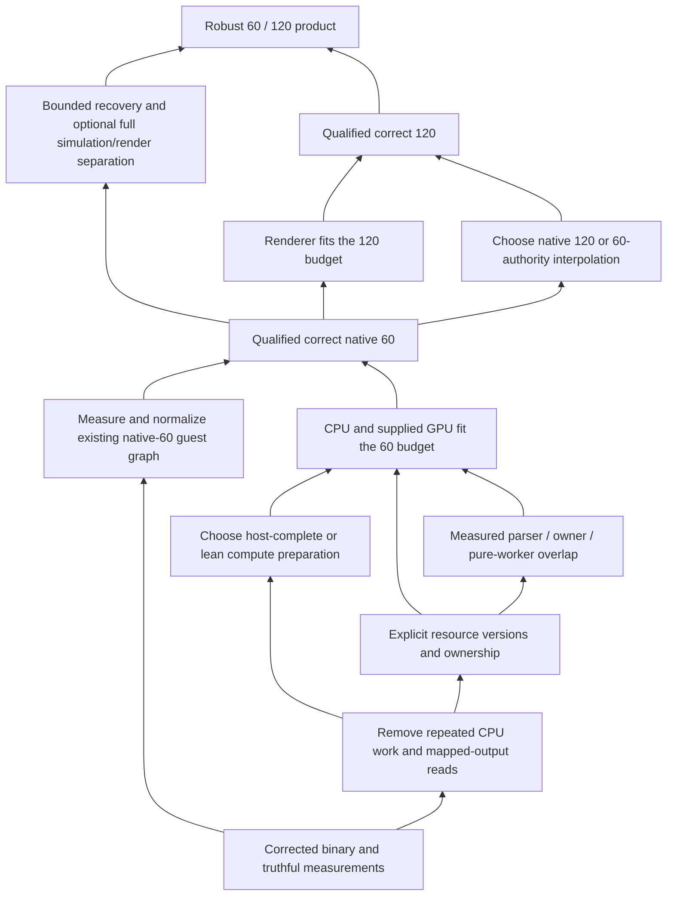

# Destiny / shadPS4: the complete route to 60 and 120 fps

Assessment and implementation plan for Claude. 12 September 2026.

This is a source, saved-log, saved-capture, and architecture review. No emulator code was changed, no build or boot was performed, and the running game was not touched. The recommendations below are work packages, not claims that their gains have already been measured.

## 1. The decision

**Keep the ordinary-pipeline indirect run executor. Refactor how its inputs are prepared, owned, and published. Do not restart the renderer.**

The current CPU path repeatedly reconstructs information, visits the same resources, and emits Vulkan state that is already established. Its GPU preparation still carries machinery from the earlier device-generated-command design. Those are identifiable costs with replaceable boundaries. The bindless/stage-block work, native indirect execution, VRAM indices, and useful parts of the mirror remain assets.

Recovering the direct-slot regression is a prerequisite, not the 60 fps solution. A return to the old approximately 34 fps operating point still leaves a substantial throughput deficit. The immediate draw memo may improve that point; its hit percentage does not tell us how much. A material-level hit still captures descriptors, hashes inputs, resolves resources, writes transient output, and eventually records runs.

**There is a credible engineering route to 60 on the observed 7800X3D / RTX 4090 system. Native 120 is a second, substantially tighter performance target. Neither is established by the measurements available today.** The old captures show poorly used hardware, expensive delivery and memory behavior, and useful responses to residency changes. They do not show a renderer running efficiently against an unavoidable hardware limit. That supports continuing this architecture, not promising an unmeasured final frame rate.

The shortest first gameplay milestone is probably the existing complete guest update graph running at a normalized native 60 Hz. It does **not** require building a new simulation scheduler first. Robust recovery from hitches and efficient independent rendering are further milestones. Treating the entire simulation/render separation project as a prerequisite for first 60 would delay useful progress unnecessarily.

For 120 there are two real products:

1. 120 rendered frames and 120 authoritative simulation ticks per second.
2. 120 rendered frames around a correctly timed 60 Hz simulation, with real render-state interpolation.

The second avoids doubling authoritative work and the associated rate-policy audit, but interpolation is a substantial integration project. It is not automatically the cheaper implementation. Measure native-120 guest capacity before committing to that project solely for performance. This report covers both routes; it does not assume repeated presents or camera-only updates satisfy 120 fps.

## 2. What “done” means, working backward

The performance target must preserve the current game workload and visual quality. The observed main render targets are 1920×1080 and the shadow target is 1536×1536; a 1280×720 window does not redefine the rendering workload. Use the current reference configuration as the initial target. Lower resolution, fewer shadows, reduced visibility, dropped effects, or frame generation can be separate options, but cannot silently count as solving this target.

| Finished state | Required behavior | What must already be true |
|---|---|---|
| Correct native 120 | 120 new renders/s, 120 successful authoritative ticks/s, correct game speed and events, acceptable pacing and latency | Rendering fits 8.33 ms with margin; guest 120 capacity and rate semantics validated; protocol time remains correct |
| Correct 120 rendering / 60 authority | 120 new views/s, 60 authoritative ticks/s, interpolated moving objects/poses, exactly-once gameplay effects | Rendering fits 8.33 ms; safe render-state adapter; explicit display/guest clocks; validated zero/one or separated scheduling |
| Robust 60/120 under ordinary hitches | Temporary stalls recover without persistent slow motion, unbounded debt, duplicate events, or stale snapshots | Sufficient spare capacity plus a bounded, complete-tick recovery policy; correct ownership if ticks/rendering are separated |
| Useful native 60 operating point | Actual native 60 advancement and 60 new renders/s in the supported load envelope | Rendering and guest update fit 16.67 ms with margin; existing 60 arm normalized; timing, gameplay, and multiplayer tests pass |
| Rendering capacity for 60 | The complete render-delivery path can sustain the workload within budget | Current regression removed; repeated CPU work reduced; GPU supplied sufficiently; remaining limiting stage identified and improved |
| Trustworthy starting point | Same source, binary, settings, scene, and clock domains produce interpretable results | Explicit provenance, low-overhead production timing, joined frame/bucket identities, correct draw/tick counts |

There are two acceptance tiers. The first is a **qualified operating point**: a defined set of scenes sustains the requested frame/tick rate with headroom. The second is a **robust timekeeping product**: a hitch does not permanently lose simulation time. Do not call the first the second. Conversely, do not make the second block every useful native-60 experiment.

An initial qualification should include a light reference view, the heavy moon view, the Earth shadow-heavy view, active combat, and the heaviest available raid/activity path. Record first-visit shader behavior separately from a warmed traversal. Include world transitions and a longer session for resource growth. A quiet static camera is an excellent controlled comparison; it is not sufficient final coverage.

Measure unpaced stage capacity as well as paced presentation. A perfectly paced 60 Hz output naturally has approximately 16.67 ms display intervals even when the renderer takes 11 ms. For a supported steady workload, require the high-percentile **service times** to retain useful margin, report deadline misses and clustered bad intervals, and verify actual ticks against admitted wall time. Report loading/compilation hitches explicitly rather than deleting them from a full-session experience claim.



The arrows are dependencies, not an instruction to implement every optional optimization. Stop adding concurrency or caches when the measured target is met with margin. Resume those options against the 120 budget when justified.

## 3. Evidence, provenance, and the limits of the present numbers

### 3.1 Which tree this report assesses

The current implementation is `D:/dev/shadPS4-nvtx`, branch `d1/nvtx-sync-points`, HEAD `579f7e69` plus substantial uncommitted work. The older `D:/dev/shadPS4-60fps` tree is not the current build. Working source and the executable changed during this review through work outside this assessment.

The observed corrected `vk_rasterizer_gpu_cp.cpp` has timestamp 01:27:55 and SHA-256:

`6492E5CA91EABC7C838E4CFA4399C30DDBAF30225EEDCEF11B6F3D6A5060CABA`

The latest executable observed here, `build-nvtx-perf/shadps4.exe`, has timestamp 01:28:29 and SHA-256:

`6CD0F98D425E5DEEE93F6B10E9B82044BD4D70E5BE30BCCDE1FE668A8873500C`

That hash identifies an observed file, not a verified post-fix performance result or proof of the complete source-to-binary provenance. Boot A used the older binary whose hash begins `39a40a815c9414d4`. Its preserved diagnosis is in the first assessment (not in the repository: `D:/dev/go-destiny/docs/perf/ASSESSMENT-20260912-command-processor.md`), with compiled-helper disassembly (not in the repository: `D:/dev/go-destiny/docs/perf/assessment-20260912-direct-slot-disassembly.txt`).

Hardware inspection established a Ryzen 7 7800X3D, 8 physical / 16 logical cores, approximately 32 GB installed RAM, and RTX 4090. The saved handoff describes Windows 11, PCIe 4 x16, ReBAR, driver 616.56, and Vulkan 1.4.351. The eight physical CPU cores must also run guest jobs, simulation, audio, driver work, and the local server.

### 3.2 The direct-slot fix is already in the observed source

The removed helper copied a resolved slot back out of GPU-visible sequential-write output to fill a CPU memo. The compiled object retained the read. The memo's material-oriented key also caused different meshes to replace each other's last direct descriptors, and its per-slot diagnostic used a locked increment.

That establishes a strong regression mechanism. It does **not** independently measure the exact latency of each PCIe read, prove every allocation's actual memory properties, or assign every added microsecond to one instruction. Measure the repaired build. The prior control `MEMO=0` still visited that helper; current source removes it from both branches. The corrected sort also rejects a range that mixes the Less and Greater comparison families. These are source fixes, not yet a measured performance recovery in the evidence reviewed here.

The updated handoff (not in the repository: `D:/dev/go-destiny/docs/perf/HANDOFF-20260912-cp-memo-sort-sim60.md`) incorporates those changes. Its later historical sections still describe the removed helper; use its amended opening and current source. Its advice to read `outer=` in `--sim60` also needs correction, discussed below.

### 3.3 Historical comparison: useful direction, insufficient final precision

The user-facing Boot 14 / Boot A summary is approximately 34 → 17 fps, 2.0 → 4.7 µs CP recording per draw, and 0.48 → 3.4–3.65 µs sampled slots phase per draw. That is a real large regression signal.

A read-only reconstruction of log buckets during this review produced the following diagnostic medians. It associated draw-phase lines with the adjacent CP reporting bucket rather than independently filtering three streams and pairing them by row number. Scene selection remains approximate and the counters do not share a proven per-present identity.

| Diagnostic quantity | Boot 14 | Boot A |
|---|---:|---:|
| Selected bucket count | 301 | 309 |
| Reported fps | 34 | 17 |
| All draws / CP frame | 11,074 | 11,828 |
| CP on-CPU ms / CP frame | 27.94 | 59.74 |
| Draw-scope elapsed µs / draw | 2.008 | 4.590 |
| GPU command-buffer elapsed ms / CP frame | 25.08 | 25.48 |
| Timed CP scopes / CP frame | 80,132 | 81,793 |

These are not matched-frame benchmark results. They illustrate two important limits: views differ, and GPU milliseconds accumulated per wall second can fall roughly in proportion to delivered frame rate while elapsed GPU intervals per CP frame remain similar. Boot A's lower GPU busy percentage does not mean the GPU work became half as expensive.

The GPU command-buffer quantity includes the elapsed intervals delimited by those timestamp queries, including stalls/dependencies inside them. It is not a direct measure of pure shading work or a proof that 25 ms must remain after CPU delivery improves.

### 3.4 The instrumentation must earn its accuracy

`CpScope` (not in the repository: `D:/dev/shadPS4-nvtx/src/video_core/d1_performance_counters.h:373`) reads `steady_clock::now()` on entry and exit. At approximately 80,000 scopes/frame, that is roughly **160,000 clock reads/frame**, before other phase clocks. At 34 fps this is approximately 5.4 million clock reads/s. Runtime phase-timer flags do not remove every compile-time scope or global counter.

Sensitivity illustration only: if each clock read cost 10 / 30 / 60 ns, 160,000 calls would cost 1.6 / 4.8 / 9.6 ms per frame. Those are **not measurements of this machine's clock cost**. They show why the clean build comparison is mandatory before assigning a 1.39 or 0.69 µs budget to real work. The timer adds instructions and can change cache/code behavior beyond the clock call itself.

The CP scopes report elapsed time in exclusive categories; the interval's on-CPU time is a separate measurement. `Liverpool::Process` (not in the repository: `D:/dev/shadPS4-nvtx/src/video_core/amdgpu/liverpool.cpp:352`) starts its active accounting after input is available. Do not describe that value as all wall time from one visible frame to the next, or add scope totals and on-CPU totals as independent costs.

GPU timing can also perturb execution. `GpuTimersReclaim` (not in the repository: `D:/dev/shadPS4-nvtx/src/video_core/renderer_vulkan/vk_scheduler.cpp:451`) waits when a timestamp slice is still in use and requests query results with a wait flag. Report those waits. Prefer delayed nonblocking reclamation or dropped diagnostic samples over forcing the production path to wait for a detailed profile. Timestamp stage semantics and overlapping execution limit interpretation; synchronized CPU/GPU timelines are more useful than subtracting two unrelated aggregates. Khronos timestamp sample (not in the repository: `https://docs.vulkan.org/samples/latest/samples/api/timestamp_queries/README.html`), calibrated timestamps (not in the repository: `https://docs.vulkan.org/samples/latest/samples/extensions/calibrated_timestamps/README.html`).

The existing comparison script (not in the repository: `D:/dev/go-destiny/docs/perf/compare-runs.py`) independently filters CP, GPU and draw-phase streams and pairs the results by ordinal. Raw stream counts differ: Boot 14 has 827 CP/GPU rows but 818 draw-phase rows; Boot A has 409 versus 399. Its scene heuristic also selects `fps < 45`, which would discard a successful improvement beyond 45. Fix the join and scene selector before using it to grade the next implementation.

### 3.5 What the older hardware captures support

The saved `GPUTRACE_FRAME.xls` exports are tab-separated text from Build 4, before subsequent changes. The first export reports about 98% graphics-engine activity but only 2.6–7.8% SM throughput, 1.3–1.8% DRAM throughput, 167–347 MB PCIe reads/frame, and 14.6–34.0% frontend wait-for-idle stall in three captured frames. Draw count varies from 7,400 to 12,429. Capture export (not in the repository: `D:/dev/go-destiny/runtime/windows-20260911-221229-677/BASE/GPUTRACE_FRAME.xls`).

Those observations support investigating imported-memory latency, dependent fetches and frontend serialization. They do not prove a particular remaining cost today. Later experiments are crucial: rect/quad admission did not eliminate fragmentation; fixing one layout oscillation did not improve fps; reducing barriers/pass ends by approximately 20% left the residual largely flat; VRAM indices improved the historical selected scene from about 30 to 34 fps; the mirror improved pass cost per draw in a heavier scene. Frame-wait research and corrections (not in the repository: `D:/dev/go-destiny/docs/perf/RESEARCH-20260911-where-the-frame-waits.md`), twin handoff (not in the repository: `D:/dev/go-destiny/docs/perf/HANDOFF-20260912-twin-and-frame-rate.md`).

The next GPU capture must be of the corrected, sufficiently supplied renderer. Do not optimize the old capture as though intervening work did not happen.

## 4. The arithmetic that every proposal must survive

At 60 fps, the frame interval is 16.667 ms; at 120 it is 8.333 ms. For a single serial CPU path that does all work associated with each draw:

| Draws/frame | Entire 60 Hz interval per draw | Entire 120 Hz interval per draw |
|---:|---:|---:|
| 8,000 | 2.083 µs | 1.042 µs |
| 11,000 | 1.515 µs | 0.758 µs |
| 12,000 | 1.389 µs | 0.694 µs |
| 16,000 | 1.042 µs | 0.521 µs |

These are generous absolute limits: parser, range close, fallback, driver and housekeeping still need time. A practical engineering target is roughly **12–14 ms per limiting stage for 60**, and **6–7 ms for 120**. The exact margin should follow observed variability. These targets are requirements, not forecasts of what the next patch delivers.

The brief's 12,000 × (1.6 + 0.36) µs is **23.52 ms**, before additional work. A perfect overlap that removes all 4.32 ms parsing from the critical stage leaves 19.2 ms preparation. It cannot by itself meet 60. Using another capture's 4.5–9 ms packet total can explain a roughly 30 ms interval, but do not mix those measurements without naming their scenes and domains.

For architecture decisions define:

* `P`: parse and owned input capture.
* `S`: serial resource decisions, ordered state transitions and recording.
* `W`: preparation that can be made independent.
* `n`: effective worker parallelism.
* `O`: queue, synchronization, publication and contention overhead.
* `G`: supplied GPU critical-path service.
* `J`: real dependency or submission gaps.

A single-thread path costs approximately `P + S + W`. If serial ownership and worker preparation remain on the same recurring non-overlapped dependency chain, an idealized interval resembles `max(P, S + W/n + O, G)`. If the owner can plan batch q+1 while workers prepare q, the independent stage constraint is instead closer to `max(P, S, W/n, G)`, with overhead charged to each stage. Neither formula is a measured equality or permission to ignore guest work. Dependency/feedback cycles, shared CPU utilization and queue limits determine which overlap is actually possible.

If preparation were 19.2 ms with a hypothetical 25% serial fraction, perfect four-worker scaling of one batch gives `4.8 + 14.4/4 = 8.4 ms` before queues and contention. That exceeds the 120 interval **if those sections remain in the same recurring critical dependency cycle**. It does not alone disprove 120 throughput when independent batches overlap. The serial fraction is illustrative, not measured. The practical direction remains to remove avoidable work before relying on more workers, then measure the actual initiation interval and latency separately.

CPU and GPU time are not simply additive in a pipelined renderer. Nor does taking their maximum prove the final rate: dependencies, resource reuse and submission starvation can introduce bubbles. Throughout this report, a stage fitting its throughput budget means its recurring service/initiation interval or non-overlappable demand fits, not that every isolated frame's latency must be shorter than the display interval. GPU pipeline stages can overlap across frames. Track both saturated completion interval at bounded queue depth and end-to-end latency. A queue that produces 60 completions/s after adding several frames of delay has not solved responsiveness.

For 120 rendering with 60 simulation, the simulation can retain a 16.67 ms cadence if it is sufficiently independent. Shared CPU resources still obey a utilization constraint: 60 times simulation work plus 120 times render work, and all other work, must fit the available cores. Sixteen logical processors do not provide sixteen independent physical cores.

## 5. What Claude should do in the morning

The morning goal is a **trustworthy repaired baseline, one bounded CPU improvement, and an actual native-60 capacity reading**. It is not to land a new scheduler, a new page table, multiview and a cadence rewrite together.

### M0 — Freeze the comparison

Record source revision plus dirty diff identity, executable hash, build options, exact effective environment, guest patch manifest, driver, scene marker and render resolution. Preserve Boot A as historical evidence. Capture the settings after all launcher overrides: a defaults JSON alone is not necessarily the effective environment.

Use the existing launcher/recipe, changing the following explicit switches. Keep simulation mode constant through the rendering comparison.

| Variant | `SHADPS4_D1_GPU_CP_MEMO` | `SHADPS4_D1_GPU_CP_SORT` | Purpose |
|---|---:|---:|---|
| B0 | 0 | 0 | Corrected same-binary control |
| B1 | 1 | 0 | Draw memo alone |
| B2 | 1 | 1 | Incremental effect of corrected sorting |
| B3, only if attribution requires it | 0 | 1 | Sort alone / interaction control |

Explicit values avoid default drift. The new `MEMO=0` restores the old direct-slot helper, but the complete binary contains other changes; call it a same-binary control, not an exact historical Boot 14 reconstruction. Use the same view and a matched traversal. Repeat a baseline after the candidate when ordinary scene variation could explain the difference. Do not require a large boot matrix if the first result already decides an experiment. B2 is a candidate until whole-range sort eligibility excludes relevant shader/storage effects, queries, stencil writes, feedback and crossed observable commands; verify reordered depth/stencil output, not just final color. Report eligible draws and runs/binds saved separately.

### M1 — Make the meters truthful

Build the **same source** with expensive per-draw diagnostics compiled out for production capacity, alongside the diagnostic build. Retain sparse coarse counters and scene/frame IDs. Runtime `CP_TIMERS=0` and `GPU_TIMERS=0` are useful controls but are not a substitute for this matched build. The existing non-perf executable is stale and cannot serve as its pair.

Join telemetry by explicit reporting bucket/frame identity and elapsed duration. Add independent counts for actual outer entries, successful fixed-step publications, completed Havok steps with their `h`, renders, submissions and presentations. The current `--sim60` output recommendation is broken because it disables the wall gate that installs/increments the advertised outer counter. Measurement must not depend on enabling a rate-changing feature.

A useful first deliverable is one compact comparison table: stage service p50/p95/p99, visible/displayed frame intervals, successful ticks/s, draw/run/range counts, actual skipped draws, output/ring high-water, and diagnostic overhead. Use an external presentation trace if available to distinguish present calls from displayed frames; PresentMon exposes those distinctions. PresentMon console documentation (not in the repository: `https://github.com/GameTechDev/PresentMon/blob/main/README-ConsoleApplication.md`).

### M2 — Take the bounded CPU win before broad concurrency

Implement dynamic-state **delta emission** in the existing run recorder. It currently replaces live state, invalidates every field, and commits every run. Compare each desired state to what was actually established in the current command buffer. Fully establish state on a new command buffer or after a path that invalidates it, including binds that specify the relevant field statically. Validate enabled/disabled depth, stencil, bias, static/dynamic pipeline alternation and fallback transitions.

Measure actual `vkCmdSet*` calls and complete recorder service. This is a tightly scoped change with a direct mechanism. In parallel planning, define CPU scratch as the authoritative record representation so future optimization cannot read sequential-write GPU output back. Do not combine the state patch with an ABI rewrite or worker launch.

### M3 — Address the specific coherence gaps before expanding the mirror

Add targeted tests for introduced aliases and same-frame index-source writes. Establish conservative invalidation/version handling where the existing cache lacks it. These are correctness prerequisites for greater caching and look-ahead; their live frequency is not established. Keep the existing useful static index/fetch path, but do not broaden classes or narrow barriers before the invariants are explicit.

### M4 — Run the existing native-60 mode as a capacity experiment

After repairing the independent meters, use the existing complete once-per-outer graph with `h=1/60`. Verify the runtime-installed rate, not just patched bytes. Record actual completed authority ticks and the guest critical jobs while rendering runs at the repaired speed. Keep this clearly labeled a lab mode until local cadence and protocol semantics are normalized.

If the guest can sustain 60 with margin, proceed with the existing graph. If it cannot, distinguish insufficient renderer throughput from expensive guest simulation or duplicated outer work. This measurement determines whether the next simulation task is local rate fixes or a deeper scheduling project.

### M5 — Select the next rendering package from the measured wall

* If the recorder is still limiting, proceed with CPU scratch, compact immutable capture, and the host-complete versus lean-compute experiment.
* If a supplied GPU exceeds the 60 budget, capture its current dependency/pass/memory behavior and select the relevant GPU package.
* If guest simulation is limiting, profile its critical job chain and core contention. Adding CP workers can make this worse.
* If service times fit but output does not, examine wake, vblank, present cadence, labels and queue backpressure.

The minimum morning handoff is a chosen next package with a measured limiting cost and an acceptance test. A list of every possible optimization is not that handoff.

## 6. CPU preparation: turn the current path into a data pipeline

### 6.1 What remains on a material-memo hit

`RunMemoKey` (not in the repository: `D:/dev/shadPS4-nvtx/src/video_core/renderer_vulkan/vk_rasterizer_gpu_cp.cpp:1545`) calls stage preparation. `PrepareStage` (not in the repository: `D:/dev/shadPS4-nvtx/src/video_core/renderer_vulkan/vk_pipeline_cache.cpp:439`) refreshes descriptors and specialization state. `ReadSharpsInto` (not in the repository: `D:/dev/shadPS4-nvtx/src/shader_recompiler/sharp_path.cpp:72`) captures descriptor paths; `HashSpecInputsOver` (not in the repository: `D:/dev/shadPS4-nvtx/src/shader_recompiler/sharp_path.cpp:147`) walks their specialization inputs. The memo key separately incorporates image/fmask addresses. The hit then copies sharps, visits written and BDA buffers, checks image landings, resolves direct slots and indices, constructs headers/tables, and assembles runs.

The correct next goal is to reduce **required operations per draw**, not maximize an already near-perfect hit percentage. Use these counters to find repeated work: sharp paths/bytes per draw; total versus unique resource requests within an ordered interval; active block bytes; runs and setters; range-close causes. Keep those detailed measurements sampled or in the diagnostic build.

Compile a capture recipe from immutable shader layout. Group common pointer-chain prefixes where valid; capture each required descriptor once; derive its specialization identity during that capture; reuse the owned result for slot planning. The current code already reuses immediately adjacent shared roots/hops, so measure the remaining duplication. Do not assume every 32-byte padded descriptor needs a 32-byte guest read if its actual format is smaller, but preserve format/alignment safety.

A pointer to an unchanged descriptor table is not proof of unchanged contents. Capture current bytes, or establish a correct read-set/content-generation mechanism. A material template should not contain the last mesh's direct addresses.

### 6.2 Establish explicit objects and owners

| Concept | Contains | Must not contain |
|---|---|---|
| `ProgramLayout` | Immutable shader generation, descriptor capture recipe, block layout and classification | Current user data, mutable descriptor cache, borrowed per-draw guest pointers |
| `DrawTemplate` | Pipeline/layout identity and stable derived state | Last mesh slots or unversioned resource contents |
| `DrawSnapshot` | Owned user data, sharp bytes, draw arguments, required register state and generations | Deferred guest reads disguised as immutable metadata |
| `ResourceTicket` | Mapping/content generation, selected backing, bindless slot generation, view/sampler identity, ordering and retained lifetimes | An address or slot number with no promise about its future meaning |
| `PreparedDraw` | CPU-local completed words and run metadata | Reads from GPU output to derive another field |
| Published output slice | GPU-visible storage with one CPU publication and explicit ordered GPU producers where needed | Host mutation/readback of published input or an untracked producer racing a consumer |
| Ordered command tokens | Draws, copies, writes, waits, signals and their semantic dependencies | A single ambiguous “done” counter |

These names are a design vocabulary, not a demand for seven heap allocations per draw. Prefer compact arenas, indices and spans with explicit lifetimes.

`const Shader::Info*` does not currently provide this immutability. `PrepareStage` and `PrimeStageSharps` mutate `pgm_base`, `user_data`, refresh state and stencil aliases; `Info` (not in the repository: `D:/dev/shadPS4-nvtx/src/shader_recompiler/info.h:412`) owns mutable sharp state. Split persistent program description from per-draw data before sharing it with workers.

Reuse the existing owned-sharp capture in `AppendResolverRecord` (not in the repository: `D:/dev/shadPS4-nvtx/src/video_core/renderer_vulkan/vk_rasterizer_resolver.cpp:964`). Do not import the old threaded resolver wholesale. Its pure packing code is useful; its assumptions about shared resource owners need a separate review. Also note that `HashSpecInputsOver` can read live tessellation constants even when given owned sharp bytes. The current VS/PS route avoids that case; future stage support must capture all external inputs.

### 6.3 Make mapped output one-way

`frame.blocks` is `MemoryUsage::Stream`; `frame.records` is `Upload`. Both request sequential-write host access in `buffer.cpp` (not in the repository: `D:/dev/shadPS4-nvtx/src/video_core/buffer_cache/buffer.cpp:36`). Upload prefers host memory, but this code does not require host-cached memory. Log the actual allocation properties before alleging a remaining measured penalty. VMA permits uncached/write-combined memory for this access mode, so preparing in cached CPU memory is the sound general pattern. VMA allocation documentation (not in the repository: `https://gpuopen-librariesandsdks.github.io/VulkanMemoryAllocator/html/group__group__alloc.html`).

The current host rereads record fields and `SortGpuRuns` (not in the repository: `D:/dev/shadPS4-nvtx/src/video_core/renderer_vulkan/vk_rasterizer_gpu_cp.cpp:1665`) traverses mapped records. Build and sort CPU metadata instead. Resolve resources and assemble the CPU-owned words in CPU scratch; publish to the assigned output slice once; retain the slice and referenced resources through the final GPU consumer. An explicitly ordered compute producer may subsequently finish its assigned fields; the invariant forbids host readback/mutation and untracked producer races, not that legitimate GPU step. CPU memoization, equality checks and sort keys must use CPU values. The old resolver's September 3 warning (not in the repository: `D:/dev/shadPS4-nvtx/src/video_core/renderer_vulkan/vk_rasterizer_resolver.cpp:1224`) already documents a similar readback regression. Enforce the lesson in the interface.

### 6.4 Stop emitting unchanged Vulkan dynamic state

`FlushGpuRuns` (not in the repository: `D:/dev/shadPS4-nvtx/src/video_core/renderer_vulkan/vk_rasterizer_gpu_cp.cpp:1049`) assigns `run.dyn`, calls `Invalidate`, then commits. `Invalidate` (not in the repository: `D:/dev/shadPS4-nvtx/src/video_core/renderer_vulkan/vk_scheduler.h:186`) marks every dynamic dirty bit. `Commit` (not in the repository: `D:/dev/shadPS4-nvtx/src/video_core/renderer_vulkan/vk_scheduler.cpp:658`) consequently reissues viewport, scissor, depth test/write, bias enable, stencil enable, restart, discard, cull/front-face, blend constants and line width, plus applicable conditional state.

The current memo saves derivation but not emission. Implement an `ApplyDesiredState` operation against the last committed state and command-buffer epoch. Track validity separately from values. Values hidden by a disabled feature must still be established before enabling that feature. State modified by a CPU fallback or new command buffer must be accounted for, as must dynamic-state invalidation when binding a pipeline that specifies that state statically. Compare normalized state at every draw against the old path, including alternating static/dynamic pipelines, and count actual calls. Accept a performance claim only when total recording service improves. Khronos dynamic-state lifetime (not in the repository: `https://docs.vulkan.org/guide/latest/dynamic_state.html`).

### 6.5 Reduce repeated resource decisions at their natural owner

The importer already caches mapping translation by granule and map epoch; the twin already memoizes exact range/class answers with sector epochs. Another per-material last-address cache duplicates the wrong identity.

Instead, identify repeated `(physical/mapping identity, content generation, extent, access class)` requests within an interval with no conflicting write. Resolve a unique request once, retain a ticket, and share the result. End or version the interval at relevant CPU/GPU writes, remaps, image landings and other producers. Dynamic addresses remain per draw; stable layout and classification remain per template.

The high-value change may be avoiding ten identical coherence decisions, not making each hash lookup 5% faster. Measure total versus unique requests and owner time to decide. An interval-wide cache without explicit invalidation boundaries simply recreates the current problem at a larger scope.

### 6.6 Shrink the representation after its semantics are stable

The actual `DrawRecord` (not in the repository: `D:/dev/shadPS4-nvtx/src/video_core/d1_gpu_cp_format.h:48`) is **704 bytes**, not 128. The block address stride is 4,096 bytes; the sequence stride is 128 bytes; the run executor consumes a 20-byte indexed-indirect argument at sequence offset 104. With 16,384 records and three retained frame slots, the record/block/sequence/address-table reservations total approximately **233.25 MiB**, before other buffers. Format (not in the repository: `D:/dev/shadPS4-nvtx/src/video_core/d1_gpu_cp_format.h:38`), capacity (not in the repository: `D:/dev/shadPS4-nvtx/src/video_core/renderer_vulkan/vk_gpu_cp.h:32`).

At 12,000 draws those strides cover 8.448 MB records, 49.152 MB blocks and 1.536 MB sequences. They are **address footprints, not measured transfer bytes**. Active block bytes are `64 + Σ align16(4 × StageBlockDwords(stage))`, already represented by `memo.bytes`. Measure its histogram. The host also copies 96 bytes of clip planes per draw even where a shader may not use them.

First preserve the existing layout while establishing equivalent host/compute output. Then use a compact run format, five-word arguments, and packed variable-size blocks if the measured bandwidth/cache benefit justifies the allocation changes. Do not change layout, resolver ownership and scheduling in one patch.

`GpuRangeStep` (not in the repository: `D:/dev/shadPS4-nvtx/src/video_core/renderer_vulkan/vk_rasterizer_gpu_cp.cpp:246`) falls back after 16,384 frame records. That is a possible heavy-scene performance cliff. Count high-water and overflow causes. Provide bounded chunked allocation or a correct fallback that preserves draws and lifetimes; merely increasing the limit is not a general solution.

## 7. Decide whether GPU preparation should remain

### 7.1 The executor does not require the resolver

At `CloseRange` (not in the repository: `D:/dev/shadPS4-nvtx/src/video_core/renderer_vulkan/vk_rasterizer_gpu_cp.cpp:314`), the current sequence is approximately:

```text
EndRendering
  -> mirror copies
  -> index-ring copies
  -> optional sort
  -> compute DispatchRange
  -> BeginRendering
  -> ordinary-pipeline indexed indirect runs
  -> EndRendering
  -> sampled-target transitions
```

`vkCmdDrawIndexedIndirect` consumes an argument buffer; it does not require compute to generate that buffer. Host-produced arguments are a valid design with the required publication and lifetime. Vulkan indirect-draw specification (not in the repository: `https://docs.vulkan.org/refpages/latest/refpages/source/vkCmdDrawIndexedIndirect.html`).

The host already knows the pipeline, stage layout, captured descriptors, direct addresses, index placement, header and run grouping. The current resolver kernel (not in the repository: `D:/dev/shadPS4-nvtx/src/video_core/host_shaders/d1_resolver.comp:195`) still looks up program descriptors, copies user registers, initializes slots, handles clip planes, derives image/sampler keys, probes tables, constructs arguments and writes a legacy 128-byte sequence. Source also retains DGC-related hash construction outside some runtime host-path branches. Inspect generated SPIR-V/device code before claiming every such instruction survives optimization.

### 7.2 Implement one controlled comparison

**Candidate A: host-complete preparation.** Build final blocks, resolved image/sampler slots and five-word arguments in cached CPU memory, then publish once. Reuse pure assembly ideas from `ResolveRecord` (not in the repository: `D:/dev/shadPS4-nvtx/src/video_core/renderer_vulkan/vk_rasterizer_resolver.cpp:1135`) and its publication (not in the repository: `D:/dev/shadPS4-nvtx/src/video_core/renderer_vulkan/vk_rasterizer_resolver.cpp:1321`). Retain the current run executor's indexed semantics, including identity indices for non-indexed draws; the old CPU resolver's non-indexed arguments are not a drop-in replacement. Preserve primitive restart, vertex/instance offsets, rect/quad handling and stage-address indexing.

**Candidate B: a run-only compute emitter.** Feed compact, already-decided inputs. Remove DGC pipeline lookup/sequence work from the compiled variant. Avoid making the GPU rediscover specialization/material identity already resolved by the host. Emit only needed blocks and arguments. Keep this when sufficiently large batches amortize dispatch and CPU packing is more expensive.

Use the same captured inputs, resource tickets, shaders and executor. Initially retain the old output layout to simplify equivalence checks. Compare CPU preparation, owner/recording, GPU resolver and subsequent graphics intervals, range latency, upload bytes, queue age, and complete frame throughput. A kernel that runs faster but adds more CPU work to an already limiting thread can lose overall.

If A wins small ranges and B wins large ranges, a hybrid is reasonable only if the common representation keeps it maintainable. Determine the crossover from a histogram of range sizes and measured work, not the current `MinRange=4` comment. Around 245 short CPU ranges/frame were reported historically. Setting `MIN_RANGE=1` could add approximately that many tiny compute dispatches and dependencies; it does not remove real attachment and guest-order boundaries.

Host completion is my preferred first structural experiment because it directly tests whether GPU preparation is still earning its cost. A win would remove dispatch/dependency overhead and let short ranges use the same backend. A loss is useful: retain a lean compute path and optimize the measured CPU owner. Neither outcome requires throwing away the renderer.

### 7.3 Handle missing pipelines and fallbacks honestly

The current skip helper marks a null sequence, increments dropped draws, and refuses the range so a later frame uses the CPU path. Its log says “to the CPU path,” but the source explicitly describes the current draw as absent. A pending pipeline also creates a skipped record. Skip behavior (not in the repository: `D:/dev/shadPS4-nvtx/src/video_core/renderer_vulkan/vk_rasterizer_gpu_cp.cpp:420`), pending pipeline (not in the repository: `D:/dev/shadPS4-nvtx/src/video_core/renderer_vulkan/vk_rasterizer_gpu_cp.cpp:557`).

The recent contiguity fix prevents a skip from losing an additional run tail. It does not make the skipped draw render. Production acceptance must count these cases. Warmed performance should have zero unexplained intended-draw loss. First-visit behavior needs a correct fallback or explicit readiness policy, rather than silently scoring missing geometry as a speed improvement. Pipeline compilation may remain a hitch source even after steady-state 60 is achieved; measure it separately and preserve shader/pipeline generation invalidation.

Precompile/prewarm may run ahead, but a draw can consume only a completed pipeline and initialized descriptor/template generation. Queue it, use an equivalent ready fallback, or measure the compile wait as a hitch. Retain old pipelines, layouts and descriptors until queued CPU records and GPU consumers retire. A generation check preventing new memo hits does not protect already queued pointers. Reject a faster candidate that executes fewer intended draws.

## 8. Resource coherence: the foundation for more speed

The mirror and importer have useful local caches. Generalizing them requires a shared statement of **which bytes a draw is entitled to read**, not just where an address currently points.

### 8.1 Four specific audits before wider caching

**Introduced aliases.** `TwinCache::Acquire` (not in the repository: `D:/dev/shadPS4-nvtx/src/video_core/renderer_vulkan/vk_twin_cache.h:114`) checks sole-alias eligibility while uploading, then cached answers depend on sector epoch. `OnGpuMap` (not in the repository: `D:/dev/shadPS4-nvtx/src/video_core/buffer_cache/buffer_cache.cpp:942`) invalidates the newly mapped VA range and bumps the importer epoch. If VA A is mirrored, VA B is later mapped to the same physical backing, and the CPU writes through B, A's VA-specific protection/sector epoch may not invalidate A's mirror. The current source does not establish the missing reverse-alias contract. This is a concrete counterexample to test, not an observed live-game diagnosis.

A conservative initial solution is global mirror validity/memo invalidation on alias-capable map changes. A more selective solution tracks physical backing and all aliases. Copy-time sole-alias validation alone is insufficient if new aliases can appear later. Align comments with the actual hook behavior.

**Same-frame index reuse.** `AcquireIndexRing` (not in the repository: `D:/dev/shadPS4-nvtx/src/video_core/renderer_vulkan/vk_rasterizer_gpu_cp.cpp:1276`) keys reused pages by source buffer/page and contiguous destination placement, without a source write generation. An index page modified between two draws in one frame can therefore reuse an earlier copy unless another mechanism prevents or invalidates it. Prove that mechanism or add content-generation validation. On a new version, allocate fresh retained storage or use the authoritative source; do not overwrite an old version still needed by prior draws.

**Mutable GPU tables.** `FlushTables` (not in the repository: `D:/dev/shadPS4-nvtx/src/video_core/renderer_vulkan/vk_gpu_cp.cpp:527`) publishes staged copies with transfer-to-compute visibility. Audit the opposite dependency as well: earlier table readers must finish before later copies overwrite entries they might read. Broad barriers elsewhere may currently provide it. This is a dependency audit, not a claim that the site has caused a demonstrated defect. It becomes critical before barrier narrowing or async compute.

**Pending uploads.** “Valid because a copy has been queued” is different from “the desired generation is available to this consumer.” Track pending upload generation and ordering point. Handle invalidation, cancellation, remapping, source writes and destination reuse while the upload is outstanding.

### 8.2 The resource contract

For each relevant physical range, the system must know or derive mapping identity, content generation, authoritative representation, pending transfers, readers/writers and retirement. It may distribute this information across existing owners; a giant universal page object is not required.

```text
capture at semantic point q
    -> resource version v selected
    -> copy/publication for v ordered before its reader
    -> reader retains selected backing
    -> later version v+1 may exist without changing what q observes
    -> retire v only after all consumers finish
```

A mapping lease keeps an import alive; it does not freeze ordinary writes to its bytes. CPU completion, command recording, queue submission and GPU execution are different milestones. Host-coherent memory removes some cache-management requirements; it does not allow overwriting in-use device inputs. Vulkan synchronization specification (not in the repository: `https://docs.vulkan.org/spec/latest/chapters/synchronization.html`).

Retain descriptor identity as well as backing: bindless slot generation, image view and sampler lifetime must survive all users. Existing image destruction already retires heap slots by scheduler tick in texture retirement (not in the repository: `D:/dev/shadPS4-nvtx/src/video_core/texture_cache/texture_cache.cpp:2368`) and bindless retirement (not in the repository: `D:/dev/shadPS4-nvtx/src/video_core/renderer_vulkan/vk_bindless.cpp:151`). Preserve that invariant when caching completed slot IDs or moving resolution ahead.

### 8.3 Minimum adversarial tests

Use small real memory/command tests with expected readback, plus pure state tests where suitable:

1. Alternate two meshes with one material: distinct direct slots and indices remain correct.
2. Rewrite one descriptor-table address between draws: each draw keeps the intended descriptor version.
3. PM4 `WriteData` updates a table before a draw: parser look-ahead observes the ordered write.
4. Draw reads A, completion signal permits guest reuse for B, GPU is deliberately delayed: A is consumed before authorized reuse.
5. CPU and GPU writes between two same-frame index uses select different content generations.
6. Introduce alias B after mirroring A, then write B: A cannot return stale bytes.
7. Unmap/remap the same VA while old work is outstanding: old and new backing lifetimes are distinct.
8. Read v, update/copy v+1, read v+1: both draws observe the intended version, including repeated updates in one frame.
9. Invalidate during a pending upload; overlap image landing and buffer mirroring; span mirrored/unmirrored pages.
10. Force small rings, wrap, overflow and delayed workers: no referenced slice is reused early and forward progress continues.
11. Mid-frame guest wait with no further submission: existing open work is submitted and its completion can wake the guest.
12. Cold pipeline replacement and CPU/GPU fallback interleaving: templates, state and run spans remain correct.
13. Force image/sampler eviction and descriptor-slot reuse with delayed GPU execution: the old draw still sees its original resource identity.

These tests address actual failure mechanisms. Matching two helpers on the same captured input cannot prove the resource's bytes will still be correct at GPU execution.

## 9. Parallelize the remaining work, with bounded ownership

### 9.1 First separate phases on one thread

Make capture, template lookup, resource planning, pure packing and publication distinct logical operations without changing scheduling. This makes equivalence failures attributable and exposes how much time is actually parallelizable. Then introduce:

1. A parser/capture producer of owned records and ordered tokens.
2. A resource/record owner for mutable caches, image state, copies and retirement.
3. Optional workers operating only on captured input and retained tickets.
4. An owner that commits completed results in required order.

Pure packing helpers can be introduced before a fully independent parser if the owner first supplies valid tickets. A full parser/recorder split is not mandatory just to parallelize a bounded packing batch.

### 9.2 Preserve reads and completion semantics, not just write order

Moving guest-visible writes to an ordered recorder is insufficient. A later parser-side descriptor read may depend on an earlier queued `WriteData`, DMA or GPU write. The first correct split should stop capture at unresolved dependencies and satisfy the needed scope. An overlay/versioned-read mechanism can optimize that later.

Classify draws/dispatches, indirect argument reads, WriteData, copies/fills, EOP/EOS/release events, semaphores, predication, WaitRegMem, CE/DE dependencies, indirect-buffer fetches, flips and map/unmap hooks. Some need ordered CPU execution, some a GPU barrier, some actual GPU completion. Turning all of them into whole-GPU waits would preserve order by destroying throughput.

The existing CP submits open work before parking on certain guest waits (not in the repository: `D:/dev/shadPS4-nvtx/src/video_core/amdgpu/liverpool.cpp:409`). Preserve that liveness rule. A completion handler must not depend on the blocked parser or a lock it holds. “Recorder consumed through q” must never be used as “GPU finished through q.”

A worker must not speculatively call the current `TwinCache::Acquire` for a future draw while the owner is still applying earlier writes. A resource answer is tied to an ordered version, not merely a thread-safe lookup. Making shared caches lock-protected does not solve that semantic race.

### 9.3 Tune for the whole machine

Start with owner-only, one helper and two helpers. Compare whole-frame service, successful guest ticks, CPU core time, owner starvation, worker starvation, queue-full waits, oldest pending record and retained memory. Batch claims rather than assuming an atomic claim and wake per draw is free. Bound queue depth and look-ahead; throughput gained by uncontrolled latency is not acceptable.

If a helper shortens CP time but steals a core from the guest's critical simulation chain, it can reduce actual game speed. The 7800X3D's eight physical cores are the relevant resource constraint. Do not make a permanent four-daemon setting the architectural starting point.

Only after state/run reduction should parallel Vulkan recording be considered. It needs independent command-pool ownership and immutable recording plans, with central coordination of resource state and submission. The current GPU CP explicitly rejects scheduler parallel recording; removing the gate alone is not an implementation. Khronos threading guidance (not in the repository: `https://docs.vulkan.org/guide/latest/threading.html`), NVIDIA command-buffer guidance (not in the repository: `https://developer.nvidia.com/blog/advanced-api-performance-command-buffers/`).

### 9.4 Optimize parsing only where its measured cost matters

The parser already maintains incremental state hashes. `NoteWrite` (not in the repository: `D:/dev/shadPS4-nvtx/src/video_core/amdgpu/liverpool.h:133`) examines register words, skips unchanged/excluded values and mixes changed keys. Potential bounded improvements include production removal of diagnostic per-word work, common-span specialization, combining comparison/update passes, and coalescing repeated writes between observable operations.

Use the existing `Pm4Dump` (not in the repository: `D:/dev/shadPS4-nvtx/src/video_core/d1_pm4_dump.h`) for replay of packet/register/hash state. It captures command buffers, nested IBs, initial register state and per-draw notes. It does **not** capture every descriptor/resource byte and asynchronous version needed for a full renderer replay. Predecode only buffers with proven byte identity and lifetime. A PM4 JIT or last-frame replay is not the next default project.

## 10. GPU delivery, residency, and real workload

### 10.1 Profile a supplied GPU and classify the remaining limit

Once the CPU can deliver meaningfully faster, use a current short capture to decide among four walls:

| Observed limiting behavior | Next experiment |
|---|---|
| GPU gaps follow late submissions or immediate preparation dependencies | Earlier bounded delivery, host completion, larger legal batches, queue/backpressure correction |
| High frontend wait/idle cost with dependency chains | Attribute range/pass boundaries and replace overbroad hazards with proved scopes |
| Long dependent memory stalls / meaningful imported traffic | Residency by measured load class; compact shader addressing; authoritative VRAM where justified |
| Actual geometry/shading work consumes the budget | Shader/fetch improvements or equivalent workload reduction; CPU-only work cannot solve this wall |

If a sufficiently supplied GPU completes equivalent frames no faster than once per 10 ms at bounded queue depth, 120 requires changing GPU work or dependencies because its recurring completion interval exceeds 8.33 ms. An isolated frame's 10 ms GPU latency does not establish that limit when pipeline stages can overlap across frames. The historical 10 ms pass subtotal is neither a measured current saturated interval nor an immutable cost. Likewise, a renderer can be underutilized yet slow because it is serialized; low SM utilization is not a usable conversion factor to a promised fps.

Use calibrated CPU/GPU timing for delivery gaps and detailed hardware capture only for a representative bounded sample. Do not run every expensive diagnostic throughout every benchmark. Vendor guidance supports batching, reduced redundant state, and useful parallel recording, while warning about submission and latency tradeoffs. NVIDIA Vulkan guidance (not in the repository: `https://developer.nvidia.com/blog/vulkan-dos-donts/`).

### 10.2 Replace barriers with the dependency they actually represent

For each range close or barrier, record reason, physical resource/alias, subresource/aspect, producer stage/access, consumer stage/access, layout change and hazard type. Distinguish RAW, WAR, WAW, layout, presentation and guest-visible completion. Count duplicate coverage by prior dependencies.

Examples: color attachment writes originate at color-attachment output; depth/stencil writes involve early/late tests; index copies publish to index input; resolver arguments publish to draw indirect; stage blocks publish to their actual graphics readers. An overwrite must wait for all earlier readers, not only the last stored reader. An unchanged layout does not remove a memory hazard. Khronos synchronization examples (not in the repository: `https://docs.vulkan.org/guide/latest/synchronization_examples.html`).

Extend the existing image-state controls (not in the repository: `D:/dev/shadPS4-nvtx/tests/d1_image_state_controls.cpp`) for reader unions and depth/stencil aspects, then validate real output. Preserve the known helmet, cascade, main depth/stencil, UI, bloom and sampled-stencil controls. `SHADPS4_D1_NARROW_STAGES=1` previously damaged the picture; it is not a general performance switch to enable optimistically.

For mirror copies, separate waiting for earlier destination readers from making source GPU writes visible. Fresh destination storage may remove a WAR dependency while retaining the source RAW dependency. Do not replace every global barrier with per-buffer barriers on principle; correct scope, batching and measured implementation cost matter. Boot 8 already disproved the simple inference that removing a percentage of barriers recovers the same percentage of residual time.

### 10.3 Expand residency using actual accesses

The current mirror uses 16 MiB VA sectors, 64 KiB validity pages, a default index/fetch class selection, descriptor-extent limits and a volatile period. An example with approximately 1 GiB allocated but only 23–30 MiB valid shows a footprint opportunity. The 512-sector ceiling permits 8 GiB separate from textures and rings; track long-session high-water before scaling this to other GPUs.

`capMiB` and `hitMiB` accumulate descriptor extents per request. Reported rates such as 24–38 GB/s are **not PCIe bandwidth measurements**. A repeatedly referenced heap descriptor may cover megabytes while the shader accesses a small subset. Measure unique pages, useful bytes, update frequency and actual hardware traffic by load class before increasing the cap or mirroring all constants/raw buffers.

Use the simplest appropriate path:

* Static fetch/index data: retain versioned VRAM reuse where profitable.
* Small frequently updated constants: transient cached CPU preparation and device-local publication may beat persistent mirror faults/copies.
* Large mixed-residency descriptors: consider page translation only after measuring which pages matter.
* GPU-authored data repeatedly read by the GPU: consider canonical VRAM ownership with correct CPU-read synchronization and partial-write preservation.

The last option is a coherent-memory subsystem project. It must handle downloads on CPU demand, image/buffer aliases, untouched bytes around partial writes, and all outstanding readers. It is not implemented by allowing written descriptors to hit the existing twin. Old PCIe-write counters alone do not establish its current value.

### 10.4 A safe paged path needs history and backing lifetime

The previously proposed host-written global table can change what already-recorded ranges observe. A range ordinal check alone does not fix this if repeated invalidate/recopy overwrites the table's history or the selected storage.

Two defensible designs are immutable/versioned table segments retained with their backing, or ordered GPU table updates paired with copies and reader retirement. Earlier readers must finish before any in-place table/backing overwrite they could observe. Keep pending versions explicit. Measure the shader-indirection cost as well as saved imported loads. Sparse buffers are an optional address-space/footprint mechanism with separate feature and synchronization requirements, not a morning prerequisite. Khronos sparse-resource guide (not in the repository: `https://docs.vulkan.org/guide/latest/sparse_resources.html`).

### 10.5 Shorten shader fetch chains if they remain expensive

The run shader prologue currently follows draw ID → stage-address table → stage block → direct slot → resource address → fetch. `spirv_emit_context.cpp` (not in the repository: `D:/dev/shadPS4-nvtx/src/shader_recompiler/backend/spirv/spirv_emit_context.cpp:205`) contains table/linear selection and a table load before selection in source. Generic pulled-index handling also remains relevant to audit when using native indexed runs.

A small run-specific variant may remove unused branches/loads, use compact layouts, separate invariant material inputs from transient per-draw data and avoid page translation for known direct classes. Inspect generated code and measure memory-dependency stalls, registers and occupancy. Source simplification does not prove the driver removed a load, and extra variants have pipeline/cache costs. Native vertex fetching is a later compatible-format experiment if translated fetch remains the demonstrated wall.

Resolution scaling is a useful diagnostic for fragment/pixel sensitivity. It changes quality, so it is not a fidelity-preserving solution to the original target.

### 10.6 Keep async compute optional and late

A larger preparation batch may overlap useful graphics work on another queue; a tiny dispatch that immediately gates its following draw usually offers little independent work. Before attempting overlap, establish immutable inputs, versioned tables/output, retained backing, correct cross-queue dependencies and any queue-family ownership transfers. Measure contention and semaphore costs. AMD RDNA performance guide (not in the repository: `https://gpuopen.com/learn/rdna-performance-guide/`).

Keep the portable graphics-queue ordinary-pipeline path. Query optional import, host-visible device-local memory, sparse resources, multiview, async queues and vendor-specific facilities. External host import and available memory types vary by implementation; retain correct staging when those facilities are absent. External-memory-host specification (not in the repository: `https://docs.vulkan.org/refpages/latest/refpages/source/VK_EXT_external_memory_host.html`), VMA usage patterns (not in the repository: `https://gpuopen-librariesandsdks.github.io/VulkanMemoryAllocator/html/usage_patterns.html`).

Cross-vendor performance qualification is a later matrix, not something a 4090 result proves. Portability is a reason to retain the current ordinary executor, not a reason to prevent profitable optional paths.

## 11. First correct native 60: preserve the existing guest graph

### 11.1 Several different clocks are currently easy to confuse

The current `--render60` selects approximately 60 outer/render opportunities while the wall gate supplies 30 Hz quantized time. It admits at most one fixed quantum per outer invocation, and guest activity/publication conditions can still prevent an advance. At `outer=16 hold=0`, if all 16 eligible iterations advance, approximately 16/30 = 0.533 seconds of physics advance occur per wall second. The animation slowdown is consistent with this architecture, without requiring a separate animation defect.

`--sim60` changes the fixed step to approximately 1/60 and removes that gate, permitting at most one advancing step per eligible ordinary outer iteration. Count successful publication/Havok completion rather than assuming every outer advances. The historical 38 advances/s therefore means approximately 38/60 = 0.633 game speed. It is a useful capacity mode, not a finished timing patch.

Keep these domains explicit:

| Domain | Meaning | What to observe |
|---|---|---|
| Source pump / outer wake | Opportunities to run the complete guest graph | Actual outer entry IDs and intervals; configured source/wake periods |
| Authoritative fixed time | Successful game-state advances | Tick IDs, installed rate, `h` bits, successful publication and Havok completion |
| Guest virtual vblank | Guest-visible video events and flip eligibility | Event counts/timestamps and flip-rate divisor |
| Host rendering / display | Construction, submission, present and scanout | Render IDs, GPU completion, present IDs and displayed intervals |
| Protocol clock | Network/session timestamp units | Source timestamp rate, application tick and client/server conversion |

The current three-write XML (not in the repository: `D:/dev/destiny1-preservation/patches/game/CUSA00219-lab-manifest-T1-60hz.xml:346`) sets source pump to approximately **16.6833 ms**, integer rate to **60**, and nominal duration to approximately **16.6667 ms**. The outer override separately uses 16,683 µs. Removing only that override does not create exact 60 because the source pump is also approximately 59.94. XML addresses `0x9918B3/C7/D1` correspond to normalized client addresses `0x5918B3/C7/D1` plus `0x400000`.

Choose and report a coherent profile: exact 60 authority may coexist with a 60000/1001 display through explicit pacing, but the conversion must be deliberate. Use rational accumulated deadlines/credit for long-term timing; one rounded microsecond period is not an exact rational clock. Verify configuration after world transitions because patched initialization bytes alone do not prove the current world-options state.

The live video-out `PresentThread` (not in the repository: `D:/dev/shadPS4-nvtx/src/core/libraries/videoout/driver.cpp:418`) derives its period from `GetVblankFrequency`, consumes at most one eligible request per virtual vblank and updates guest vblank events in the same loop. Raising that setting changes guest event delivery as well as presentation opportunity. It does not independently fix outer wake or simulation authority.

### 11.2 Repair observation without changing behavior

The launcher (not in the repository: `D:/dev/go-destiny/scripts/boot-windows.py:309`) clears `SHADPS4_D1_FIXED_30_WALL_GATE` for `--sim60` but recommends reading the gate's `outer=` output. The outer callback (not in the repository: `D:/dev/shadPS4-nvtx/src/core/d1_outer_wake_5994.cpp:136`) is installed/counts under gate arming, and logging (not in the repository: `D:/dev/shadPS4-nvtx/src/core/d1_flip_rate_probe.cpp:178`) is conditional. That recommendation cannot provide the claimed independent meter in the gate-absent mode.

Reuse existing clock trace definitions (not in the repository: `D:/dev/shadPS4-nvtx/src/core/d1_clock_trace_format.cpp:40`) and balanced Havok probes (not in the repository: `D:/dev/shadPS4-nvtx/src/core/d1_clock_trace_b1_format.cpp:51`). Count outer entries, successful fixed publication near `0x74A984`, and paired Havok entry/return around `0xCACE80` / `0xCACEB5` with the effective `h`. Keep observations sparse and ABI-preserving. Confirm observer-on/off behavior, gate-on/gate-absent behavior, unchanged incoming timestamp in observation-only mode, and no conflicting detours.

Existing outer gateway, flip-rate probe and outer-wake control test targets are declared in tests/CMakeLists.txt (not in the repository: `D:/dev/shadPS4-nvtx/tests/CMakeLists.txt:214`). Extend those touched paths with focused observation controls. Rendering counters should identify distinct frame construction, not merely calls to flip.

### 11.3 Measure native-60 capacity before restructuring ownership

Run the existing complete graph once per ordinary outer at `h=1/60`. Do not clone job tables or loop Havok. Observe the guest critical chain, especially physics, controller/vehicle updates, actor jobs and retirement/drain waits, while recording the CPU resources used by the renderer and server.

If corrected rendering can sustain sufficient outer throughput and actual advancing ticks reach 60, this is the shortest base for native 60. Success does not require a new host event ledger or render snapshot schema: the existing ordinary graph already has an execution and lifetime contract. The remaining task is to verify and normalize its rate-sensitive behavior.

If ticks remain below 60, classify why. A slow CP may prevent new outer opportunities; a guest job can consume the freed capacity; extra renderer helpers can contend with that job. The actual critical path determines which component to optimize. If the authoritative work itself cannot fit, simply making presentation faster will not accelerate it.

### 11.4 Normalize policies that count invocations or ticks

The 97-reference fixed-delta census (not in the repository: `D:/dev/destiny1-preservation/design/d1-clock-and-frame-pipeline-contract.md:589`) is a testing/audit surface, not 97 known defects or 97 automatic replacements. Many arithmetic uses should naturally change with `h`; some thresholds and service policies should preserve wall-time meaning. The static census was independently checked against the existing client during this review.

Concrete starting points include `0x9159e0` per-call countdowns, modulo-six fallback and four-tick scheduling, `0x634220` every-fifth service, and `0x63f300` gear-stage counters. Classify each as a real per-step operation, wall-time duration, service cadence, protocol quantity, or unresolved policy.

| Policy originally every… | Duration at 30 Hz | Unchanged at 60 Hz | Unchanged at 120 Hz |
|---|---:|---:|---:|
| 4 ticks | 133.33 ms | 66.67 ms | 33.33 ms |
| 5 ticks | 166.67 ms | 83.33 ms | 41.67 ms |
| 6 ticks | 200.00 ms | 100.00 ms | 50.00 ms |

If a six-call service means 200 ms, use a duration deadline or rate-scaled cadence for **that service**. Do not run its whole containing player/gear function every second tick; that may omit genuine per-tick gameplay. Preserve maintenance tails, transfers and lifetime effects while modifying the policy. See legacy policy classification (not in the repository: `D:/dev/destiny1-preservation/design/d1-clock-and-frame-pipeline-contract.md:1350`).

Smaller physics steps can change numerical trajectories even with the correct wall rate. Same-rate scheduling equivalence should be strict where deterministic. Cross-rate gameplay validation needs justified tolerances for outcomes, rather than insisting that every physics bit match 30 Hz or accepting arbitrary “feels fine” differences.

### 11.5 Keep network time explicit

The Go server currently emits timer fields in seconds × 30 (not in the repository: `D:/dev/go-destiny/internal/activityhost/pvp_state.go:25`), a 30-unit/s PvP stamp (not in the repository: `D:/dev/go-destiny/internal/activityhost/pvp_state.go:51`), and milliseconds-per-tick metadata (not in the repository: `D:/dev/go-destiny/internal/activityhost/pvp_state.go:112`). Other services use a 250 ms host ticker (not in the repository: `D:/dev/go-destiny/internal/activityhost/activityhost.go:740`) or a 4 Hz script cadence. These are separate domains.

Client timer synthesis combines received stamps, context milliseconds/tick and local rate/frame getters. Client clock research (not in the repository: `D:/dev/go-destiny/docs/trials/research/E4-timer-and-clock.md:51`). Preserve a stable protocol clock or convert it explicitly at the boundary. Do not double all host ticker frequencies because client simulation now runs at 60. A valid design can simulate at 60/120 while transmitting a protocol cadence appropriate to the existing server.

Track packet/event sequence, source time, receive time and application tick. Test two peers with different presentation rates, consistent round timers, reconnect continuity, event counts and delayed/lost packets. A local high frame rate that makes multiplayer clocks drift is not a completed mode.

### 11.6 Native-60 acceptance

The first capacity experiment can use a short movement/weapon/timer/two-peer sanity check. Final qualification needs the following behavior groups:

* Movement/physics: walk and sprint distance per wall second, jump height/flight time, slopes, moving platforms, vehicles, knockback, contacts and projectile/grenade behavior.
* Combat/animation: fire cadence, ammo, reload/ADS, recoil, melee windows, root motion, animation notifies, attachments, damage and AI telegraphs.
* Time/services: regeneration, cooldowns, buffs, revive/round/encounter timers, audio/effect spawn counts, cloth and maintenance behavior.
* Lifecycle/network: pause, loading, world/activity changes, respawn, teleport, object reuse, disconnect/reconnect and two-peer operation under latency/loss.

Record actual authority advancement divided by admitted wall time, not just fps. At a sustained 50 ticks/s under `h=1/60`, physics still runs at approximately 0.833 speed. A momentary dip is not the same as a permanent offset, but returning to exactly 60 ticks/s cannot recover already lost fixed time. Report this limitation at the first qualified operating point; fix recovery as the next robustness milestone.

## 12. Hitches and separation: choose the smallest architecture that works

### 12.1 The current gate can repay retained debt only through available outers

The current gate spends at most one quantum per invocation and cannot create more invocation opportunities or run multiple ticks inside one outer. It can repay retained debt when later eligible outer throughput exceeds the authority rate: returning to approximately 60 outer/s under the 30 Hz gate can do this. Returning only to the required authority throughput cannot. Its eight-quantum credit cap also discards sufficiently large deficits instead of retaining them indefinitely. Increasing `h` for one large physics step would change collision/integration behavior; it is not equivalent to completing the missing fixed steps.

A bounded debt policy must distinguish normal elapsed time, intentional pause/loading, exceptional suspend, credit admitted, credit discarded, ticks completed and maximum retained debt. It must avoid an unbounded spiral where catching up generates more work than the machine can execute. Any deliberate time discard should be explicit telemetry, not hidden in a reassuring average tick rate.

### 12.2 Consider whole-outer catch-up before inner graph extraction

A potentially smaller intermediate experiment is to run successive ordinary complete outer iterations using existing lifetime boundaries, immediately allowing another when bounded authority debt remains. This repeats ordinary render/outer services too, so it may be inefficient or unable to recover when rendering is limiting. Existing wake, overlap, present/backpressure and event behavior must be examined; the current gate does not already provide it.

The advantage is avoiding re-entry into an unfinished mixed job graph. Do not equate this with looping only Havok or invoking F1–F10 again before their children retire. If whole-outer catch-up is correct and cheap enough, it can improve the first native-60 mode without the full extraction project. If repeated rendering prevents recovery, that is evidence for separating complete authority from presentation.

### 12.3 Reuse the existing fixed-step scaffold, but finish the adapter

The code already contains exact-credit/transactional tick arithmetic in `ExactClock` (not in the repository: `D:/dev/shadPS4-nvtx/src/core/d1_clock_pipeline.h:236`), terminal obligations and real payload/read-lease storage in `SnapshotPool` (not in the repository: `D:/dev/shadPS4-nvtx/src/core/d1_fixed_step_runtime.h:145`), cadence planning, occurrence tracking and a terminal ledger.

This is meaningful reusable work. It is not an installed complete game adapter. Source search found no production caller of `FixedStepRuntime::Create` (not in the repository: `D:/dev/shadPS4-nvtx/src/core/d1_fixed_step_runtime.cpp:340`) outside its definition. The mechanical capability set (not in the repository: `D:/dev/shadPS4-nvtx/src/core/d1_live_scheduler_plan.cpp:204`) only marks four implementation capabilities; the owner declares incomplete obligations (not in the repository: `D:/dev/shadPS4-nvtx/src/core/d1_live_scheduler_owner.cpp:194`) and lacks a complete Z0/ZP route (not in the repository: `D:/dev/shadPS4-nvtx/src/core/d1_live_scheduler_owner.cpp:406`). Do not enable missing capability flags as a shortcut.

The preservation repository's implementation runbook (not in the repository: `D:/dev/destiny1-preservation/design/d1-fixed-step-simulation-implementation-runbook.md:367`) describes the required integration. Some older documentation inventories predate current scaffolding; use current source for what exists and the contract for required behavior.

### 12.4 Why a complete tick is much more than a physics call

The guest registration graph has 14 primary F jobs, 8 X jobs and 7 Y jobs. The static registration/table counts and cross-dependencies were checked in the existing client. Rendering and late primary work overlap; a convenient contiguous set of F wrappers is not automatically an isolated tick.

The following is a navigation map for the **later separated scheduler**, not a checklist before testing ordinary native 60:

| Region | Required ownership decision |
|---|---|
| F0 `0x74a420` | Wall/session/network/playback publication contains outer work; do not repeat it blindly per inner tick |
| F1 `0x74a780` | Fresh input/fixed block, successful advance and gameplay publication must form a complete ordered occurrence |
| F2 `0x74ab30` | Send/receive child submissions and shared handles need occurrence identity; ingress and application are distinct |
| F3 `0x74ac50` | Delayed actor jobs and their retirement belong to the correct tick |
| F4 `0x74ad10` | Projectile/damage/raycast queues and defer boundaries preserve per-tick order |
| F5 `0x74adf0` | Controller/vehicle work and maintenance tail must be separated by meaning, not skipped wholesale |
| F6 `0x74af30` / F8 `0x74b5a0` | Fresh shared-group/stack-handle ownership; one matching consumer/reset generation |
| F7 `0x74b480` | One Havok advance and required visual sidecar per completed tick |
| F9 `0x74b650` | Preserve post-physics core and surrounding contexts |
| F10 `0x74b770` | Six drains, gear enqueue, visual/device block close and eventual reuse have distinct ordering |
| F11–F13 and X/Y | Camera/render/audio/cloth/transport work must be classified against complete generations |

Cross-dependencies include X0←F1, X1←F10, X2←F11, X4←F12, F13←X5, Y0←X7, and conditional F12←X3. These prevent treating the table as a simple simulation prefix followed by render suffix. 29-job contract (not in the repository: `D:/dev/destiny1-preservation/design/d1-clock-and-frame-pipeline-contract.md:701`).

Important concrete boundaries:

* F1's fresh block path includes `0xfc4e0 → 0x232920 → 0xb9d180 → 0x232940` or playback handling; `(block_flags & 0x2) != 0` controls the advancing path through `0x590a50`. `0xb9d270` is a transfer, not proof of final retirement. Input construction near `0xba5c00` consumes one-shot data. F1 extraction contract (not in the repository: `D:/dev/destiny1-preservation/design/d1-clock-and-frame-pipeline-contract.md:775`).
* F5 contains ordered controller/vehicle work and a maintenance tail. Queue clearing and runtime-pressure/lifetime effects must remain where their consumers require them. Do not remove them merely because their names sound like housekeeping. F4/F5/F6 contexts (not in the repository: `D:/dev/destiny1-preservation/design/d1-clock-and-frame-pipeline-contract.md:876`).
* F6's enabled path initializes twelve handles; its fallback path does not produce the same initialized array. Invalid handle values can be legitimate. Fresh occurrence storage must reflect the path actually taken.
* F10's six drain sites include `0x74b84b`, `0x74b857`, `0x331046`, `0x331058`, `0x32e09d`, `0x74b8f2`. Gear `0x63f300` runs after the final drain and may enqueue work for the next tick. Adding an extra drain changes that schedule. The block close at `0xb9d310` and later playback/bit branch are not the same as allocator reuse. F10 contract (not in the repository: `D:/dev/destiny1-preservation/design/d1-clock-and-frame-pipeline-contract.md:1022`).
* Worker return, generation invalidation, free publication and a state-7 requeue are different completion events. A parent fence alone may not establish allocator retirement. Model actual occurrences and generations, not callback addresses alone. Application/retirement contract (not in the repository: `D:/dev/destiny1-preservation/design/d1-clock-and-frame-pipeline-contract.md:1579`).

### 12.5 Prove exact-stock grouping before live variable tick counts

First extract one complete tick at the stock fixed rate and preserve all terminal obligations. Then compare the same inputs/network application under ordinary `[1,1]` versus grouped `[2]`, `[1,1,1]` versus `[3]`, and zero/advance patterns such as `[0,2]`. Compare authoritative state, ordered events, queue contents and lifetime/retirement behavior. Explain unavoidable nondeterminism and any tolerance; do not accept only “no crash.” Differential runbook (not in the repository: `D:/dev/destiny1-preservation/design/d1-fixed-step-simulation-implementation-runbook.md:387`).

Zero ticks also has more than one state: Z0 has no block; ZP has a valid published block with the advance bit clear and still requires close/release. Existing defer-context transitions and drain ownership cannot be omitted by returning early. Only after these contracts pass should wall credit choose variable tick counts. Accumulator integration (not in the repository: `D:/dev/destiny1-preservation/design/d1-fixed-step-simulation-implementation-runbook.md:415`).

For the new boundaries, assign each input edge and received gameplay event to exactly one authoritative tick. Held input state can persist; a press/release edge must not duplicate across catch-up ticks or vanish in a zero-tick render. Rendering consumes event-derived visual state without reapplying damage, audio triggers or authoritative spawns. The ordinary native-60 graph does not need this whole new ledger; the separated scheduler does because it changes ownership.

## 13. The path from qualified 60 to qualified 120

### 13.1 Measure the entire 8.33 ms problem again

Do not extrapolate a 60 result linearly. Build the heavy-scene draw/run/pass/guest profile at the faster operating point. Identify the largest serial stage, GPU critical path, guest capacity, high-percentile spikes, memory high-water and display/queue limitations. The second performance reduction may expose a completely different wall.

At 12,000 draws/frame, 120 requires 1.44 million draws/s and permits only 0.694 µs/draw for the entire serial draw-related path. Shader compilation, range close and guest work still exist. The desired architecture has capture proportional to required input bytes, planning proportional to unique resources/changes where ordering permits, state/API work proportional to actual changes/runs, and compact sequential publication. If ordinary per-draw work remains too expensive, structural sharing becomes necessary.

A useful first 120 decision experiment is guest capacity under the existing complete graph with the proposed 120 timing profile, clearly labeled unnormalized lab behavior. This tests whether native 120 is even a plausible short route. It does not validate game semantics. If guest work and rendering fit with margin, native 120 may require less new architecture than full interpolation. If guest authority does not fit while rendering does, 60-authority interpolation becomes attractive. If rendering exceeds 8.33, both routes need renderer work.

### 13.2 Reduce work across repeated draws before assuming multiview

There are distinct opportunities with different correctness proofs:

| Technique | What it can save | What it does not establish |
|---|---|---|
| Template/capture reuse | Repeated CPU derivation | Stable dynamic bytes or permission to reuse old commands |
| Safe run sorting/merging | Pipeline/state changes and CPU API calls | Fewer GPU primitives |
| Native indirect multi-draw | Command emission overhead | Elimination of constituent draws |
| Instancing | Frontend/CPU cost for truly compatible repeated geometry | Compatibility merely because material matches |
| Cascade preparation sharing | Repeated mesh/material/resource preparation | One rasterization serving all four views |
| Multiview | Potential shared submission/setup across compatible views | Automatic fourfold shader or frame speedup |
| Whole-pass reuse | All work in a truly invariant pass | Invariance from similar-looking images or stable addresses |

The corrected depth sort fixes the mixed comparison-family counterexample, but eligibility must still exclude color writes, storage/atomic side effects, relevant query results, attachment feedback and intervening observable commands. Compare final depth/stencil and side effects under permutations, including equal depths, coverage, bias, clipping/discard and transitions. A final color screenshot alone is insufficient. Keep sorting within proved ranges.

The historical Earth scene attributed about 63% of draws to shadows. Under a highly optimistic assumption that fourfold sharing removed three quarters of **all CPU cost associated with those draws**, whole CPU work would improve by at most `1 / (0.37 + 0.63/4) ≈ 1.90×`, not 4×. Real savings can be lower because per-view work remains and that scene proportion is not universal.

For cascades, first build the actual producer/consumer graph. The current trace comments describe a 1536×1536 target written and sampled four times per frame, suggesting sequential target reuse that must be resolved. Compare draw lists, geometry/index identity, transforms, bias, clipping, visibility/culling and consumers. If a later pass consumes each cascade before its storage is overwritten, converting it to array layers requires redirecting consumers equivalently.

Multiview uses views/layers and `ViewIndex`; it does not promise one vertex invocation for all views. Different cascade culling sets can make broadcasting their union more expensive. Try preparation sharing first, then compatible instancing/state consolidation, then multiview on proved subsets. Stop if extra per-view geometry costs more than the saved frontend/CPU work. Vulkan multiview semantics (not in the repository: `https://docs.vulkan.org/refpages/latest/refpages/source/VkRenderPassMultiviewCreateInfo.html`).

### 13.3 Native 120 authority

This is the direct extension of normalized native 60 if measured capacity permits it:

1. Declare a coherent 120 timing profile through source pump, nominal rate, installed world options, fixed `h`, wake and display.
2. Measure actual 120 authoritative completions and renderer/display behavior using independent meters.
3. Revisit the classified duration/service/protocol policies at 120. A correct 60-specific constant is not necessarily a general rate-independent implementation.
4. Repeat cross-rate physics/gameplay tests, especially contacts, projectiles, thresholds, damping, animation and weapon cadence.
5. Preserve protocol units/cadence explicitly and repeat two-peer/lifecycle qualification.
6. Apply the chosen bounded recovery policy and verify it has enough spare capacity.

This mode offers more frequent authoritative updates if successful, but doubles that work versus 60 authority. Neither the current 7800X3D nor the game graph has been demonstrated to meet it across the target scenes. That is the largest outstanding feasibility question beyond the renderer's own 8.33 ms requirement. A failure here does not disprove 120 rendered frames with 60 authority.

### 13.4 120 rendering with 60 authority: first safe integration

The minimal structural candidate keeps the ordinary graph at approximately 120 opportunities/s and generalizes the zero/one gate to allow 60 advancing ticks/s. Existing no-advance iterations must remain valid. Add a real render-state interpolation adapter. This does not inherently require multiple inner ticks per outer or F-table cloning, but it repeats outer work and remains vulnerable when outer throughput falls below authority demand.

The more efficient architecture runs complete authority independently and renders from immutable published snapshots. It avoids repeating irrelevant simulation/session work twice per tick and permits multiple complete catch-up ticks without duplicate renders. Choose it when the simpler graph cannot meet capacity/recovery or when its overhead justifies the integration cost.

Both require actual render-state access. Replaying last frame's PM4 while changing one camera constant does not update all object poses, skinning, visibility, LOD, viewmodel, effects and resources. The existing `RepeatProbe` (not in the repository: `D:/dev/shadPS4-nvtx/src/video_core/d1_repeat_probe.h`) hashes selected draw/pipeline/descriptor state; it is not a pixel-identity or unique-motion proof. Some current render paths may already interpolate particular quantities, but this review found no established complete adapter to reuse as a finished feature.

### 13.5 Define the render snapshot before writing interpolation code

Inventory each render-visible datum with writer, publication point, reader jobs, identity/generation, lifetime and discontinuity rule. At minimum cover object transforms, skeleton/animation pose, camera and viewmodel, visibility/LOD/bounds, resource references, attachments and effect state. Generic snapshot byte storage already exists; the missing work is the D1 schema and extraction/consumption contract.

Publish only a complete generation. Pin all snapshots and referenced resources while asynchronous render jobs or GPU work require them. Three slots alone do not prove sufficient lifetime; a slot may be current, previous, being written or pinned by a delayed consumer. Bound queues and handle exhaustion explicitly.

Interpolate render transforms and poses, without advancing authoritative collision or re-emitting gameplay events. Bone interpolation should respect local pose/topology and animation semantics, not blindly lerp final matrices. Handle spawn/despawn, teleport, respawn, world changes, object-ID reuse and timing-rate changes by reseeding or explicit discontinuity policies. Alpha and previous/current generations must come from one coherent clock epoch. Snapshot/interpolation contract (not in the repository: `D:/dev/destiny1-preservation/design/d1-clock-and-frame-pipeline-contract.md:1479`), snapshot runbook (not in the repository: `D:/dev/destiny1-preservation/design/d1-fixed-step-simulation-implementation-runbook.md:430`).

Standard previous/current interpolation typically adds about one simulation tick of visual latency: approximately 16.67 ms at 60 authority or 33.33 ms at 30. Measure this tradeoff. A late visual camera can improve local responsiveness if kept separate from authoritative aiming/fire decisions, but it does not make every object responsive at 120 authority. Avoid introducing extrapolation as an unexamined substitute; discontinuities and collision can produce visible correction errors.

At 120/60, qualify moving objects and skeletons with motion/pose timestamps, not just a 120 flip counter. A scene with 120 presents but only 60 pose changes has not passed the intended smooth-render criterion.

### 13.6 Make presentation policy explicit

Separate host display cadence from guest virtual vblank when the chosen mode requires it. The current video-out loop couples event delivery and request consumption; a global frequency edit is not a complete 120 path. Check flip-rate divisors, outer source timing, queue limits and labels alongside swapchain/present mode and actual monitor capability.

Track input age, snapshot age, queue age and display latency. Bound backpressure so the game does not run several frames ahead just to display a good throughput number. If stale presentation opportunities are discarded, preserve their guest-visible completion/resource-release semantics; never discard authoritative ticks or gameplay events merely because a render is late. Early label clearing must follow the actual guest buffer-reuse contract.

On a display unable to scan out 120 Hz, unpaced service can establish rendering capacity, but it cannot demonstrate visible 120. Final visible qualification requires the intended display path. This is a measurement boundary, not a reason to delay renderer optimization.

## 14. Claude's implementation queue and decision gates

This table turns the research into bounded changes. A package should have an isolated comparison or equivalence mode until accepted. Keep the known-correct baseline reachable. There is no justified calendar estimate for the whole project before the repaired measurement; the table specifies evidence that ends each phase instead of inventing dates.

| Order / package | Concrete deliverable | Depends on | Acceptance and decision |
|---|---|---|---|
| P0: repaired baseline | Corrected memo/sort controls, source/binary provenance, matched scene | Existing direct-slot fix | No new regression; independently measure memo and sort; do not infer speed from source |
| P1: trustworthy telemetry | Joined IDs, coarse production meters, matched diagnostic-off build, actual tick observer | P0 | Explain diagnostic overhead; no FPS-based exclusion of fast results; gate-absent tick/outer observation works |
| P2: state emission | Desired-versus-committed dynamic state with validity/epoch rules | P0 | Draw-state equivalence including static pipeline/fallback transitions; fewer calls and lower recorder service |
| P3: one-way publication | CPU-owned record/sort/packing scratch and explicit output ownership | P0 | Equivalent blocks/arguments; host does not derive values by rereading sequential-write output |
| P4: coherence gaps | Alias-aware invalidation, index content versions, table/publication audit | P0 | Real version/alias/ring tests pass; retained buffer/descriptor generations are explicit |
| P5: immutable preparation | Program layout, capture recipe, owned draw snapshot and retained resource tickets | P3, relevant P4 contracts | Alternating meshes, rewritten tables and shader replacement remain correct; capture/hash work reduced |
| P6: preparation choice | Host-complete versus compile-time run-only compute using common executor | P3/P5 | Choose by whole-machine interval and latency; retain hybrid only for measured crossover |
| P7: unique-resource planning | Deduplicate decisions inside proved ordered intervals | P4/P5 | Fewer owner requests, correct version boundaries, reduced owner service |
| P8: overlap if needed | Parser/owner split and/or pure packing workers with bounded queues | P4/P5, ordered dependency taxonomy | Better complete rate and latency; no guest slowdown from contention; all liveness tests pass |
| P9: supplied GPU improvement | Current capture selects hazard, residency, fetch or workload change | CPU delivery adequate for diagnosis | Recurring GPU completion interval improves; fidelity and dependency tests pass |
| S0: native-60 capacity | Truthful clocks and actual advancing-tick profile on existing graph | P1, enough renderer progress | Determine guest capacity versus renderer limitation without new graph re-entry |
| S1: normalized native 60 | Targeted rate-policy and protocol fixes, lifecycle/gameplay qualification | S0 | Correct authority/wall ratio, timers/events and two-peer behavior at sustained 60 |
| Q60: first qualification | Supported-scene report with headroom and stated hitch behavior | Required P packages + S1 | 60 rendering and native advancement; no intended-draw loss or unexplained corruption |
| R0: bounded recovery | Whole-outer experiment or chosen complete-tick extraction | Q60 or demonstrated timing need | Artificial hitch recovers according to policy; no duplicated effects or unbounded debt |
| P120: renderer reduction | Compact output, remaining useful overlap, fetch/residency and structural sharing as measured | Q60 measurements | 120 completion capacity with bounded queue/latency in target scenes |
| S120-A: native authority | Coherent 120 profile plus rate/gameplay/network normalization | Native-120 capacity evidence | Actual 120 advancement and correct behavior; retain explicit recovery policy |
| S120-B: 60-authority render adapter | Safe snapshots/interpolation and deliberate display/guest clocks | Validated 60 authority | 120 distinct motion samples, exactly-once authority/events, acceptable added latency |
| Q120: qualification | Same scene/fidelity matrix, declared authority mode | P120 + chosen S120 route | Sustained 120 rendering with correct chosen authority and bounded presentation age |

P2, the design/testing part of P4, and simulation observation can be developed independently. P5/P6 touch the same rendering representation and should be integrated deliberately. Do not have several implementations independently mutate `Shader::Info`, resolver ABI and resource ownership in parallel and then attribute the combined result to one change.

P8 is conditional. A cleaned single-thread path that meets 60 with margin should qualify that milestone before a broad split. P9's selected work is conditional too: if the supplied GPU already meets the target, do not rewrite its hazard system solely because it looks inelegant. Correctness gaps remain obligations even when they do not improve fps.

### The decision after each capture

1. **Is the workload equivalent?** Compare intended/executed draws, passes, effects, quality and actual simulation advancement. If not, repair correctness before grading speed.
2. **Is the measurement trustworthy?** Check build/settings identity, scene, clock domains, instrumentation and queue depth. If not, repair that measurement, not the renderer based on it.
3. **Which recurring stage or dependency cycle misses the budget?** Select one package that changes that cost. A faster nonlimiting stage may be useful headroom but cannot be credited with an immediate frame-rate gain.
4. **What exact mechanism should improve?** Examples: fewer state calls; fewer unique resource decisions; no resolver dispatch; fewer imported reads; shorter owner queue; fewer repeated cascade preparations.
5. **Did the mechanism and complete outcome improve?** If local counters improve but the frame does not, identify the new wall or contention before adding more complexity.
6. **Is the target now met with acceptable variability and semantics?** Qualify it. Do not keep refactoring through the entire table simply because the table exists.

### What to retire, what to preserve

| Component | Recommendation |
|---|---|
| Ordinary graphics pipelines and native indirect runs | Preserve as the common execution backend |
| Useful bindless/stage-block shader infrastructure | Preserve; specialize/compact only where measured |
| VRAM index/fetch residency | Preserve gains; add explicit content/alias lifetime contracts |
| Material-level pipeline/layout memo | Preserve stable metadata caching; remove transient last-mesh assumptions |
| Removed direct-slot memo | Keep removed; do not reintroduce CPU reads of mapped output |
| DGC-shaped preparation in the run path | Replace or minimize if host-complete/run-only comparison wins |
| Shared mutable per-draw `Shader::Info` | Split before dependable worker use |
| Unconditional per-run dynamic-state invalidation | Replace with correct validity-aware delta emission |
| Global unversioned future-visible table updates | Do not generalize; require ordered publication/history/backing lifetime |
| Older threaded resolver | Reuse owned capture and pure assembly; do not enable wholesale based on helper agreement |
| Exact-clock/snapshot/terminal scaffolding | Preserve; integrate only the adapter required by the chosen scheduling milestone |
| Entire custom CP / renderer | No present evidence justifies scrapping it |

### Explicit reasons to change course

* If host completion increases the limiting CPU interval more than it saves in GPU/setup demand, retain lean compute; do not insist that CPU generation is ideologically better.
* If workers increase guest critical-path time or queue age, reduce them. If pure work is already small, stop threading and reduce serial decisions/API work.
* If supplied GPU throughput remains below target after delivery/residency, optimize real GPU work/dependencies. More CPU threads cannot fix that measured limit.
* If native 60 guest work is too expensive after renderer contention is removed, assess stock-rate interpolation or guest-work optimization. Do not call 60 present calls native 60.
* If native 120 guest capacity exists, compare its targeted semantics work with the interpolation adapter before choosing a larger separation project.
* If ordinary outer work at 120 is too expensive or cannot recover authority debt, activate full separation. Do not repeatedly patch the zero/one gate hoping it can create capacity.
* If exact fidelity at 120 proves beyond the available hardware after measured structural work, state the observed remaining limit and offer separately labeled quality or authority tradeoffs. Do not redefine the original target retroactively.

## 15. The handoff Claude should return for every package

Use one compact record rather than another optimistic narrative:

```text
Package and hypothesis:
Source revision / dirty diff identity / binary hash:
Exact effective configuration and guest timing profile:
Matched workload and scene interval:
Correctness checks and intended/executed draw counts:
Actual authority ticks / admitted wall time:
Production recurring stage/completion intervals, p50/p95/p99:
Frame/display intervals, misses, queue age and input/snapshot age:
Mechanism counter before -> after:
Diagnostic overhead and any measurement exclusions:
Cold/first-visit behavior and long-session resource high-water:
Accepted / rejected / needs one named missing measurement:
Next limiting stage and chosen next package:
```

An initial performance margin target can be p95 recurring service near or below 14 ms for 60 and 7 ms for 120, with p99/deadline-miss behavior reported against 16.67/8.33 ms. Those are proposed engineering criteria, not a claim that isolated end-to-end latency must fit one interval or that an OS never stalls. Tighten qualification against the observed heavy-scene distribution and acceptable experience. Track clustered misses, not only percentiles: two seconds of slow motion can hide inside a good long-run average.

For robust timing, inject bounded stalls such as 50–100 ms in a controlled test, then measure admitted credit, completed ticks, recovery duration, discarded credit, duplicate/missing events and maximum queue age. A test must observe actual recovery, not merely resumed 60/120 presentation. Avoid letting the diagnostic injection itself affect unrelated resource ownership.

No single verifier, screenshot, utilization percentage, warm static-camera average or successful boot establishes completion. The necessary evidence is finite: equivalent workload, correct bytes/lifetimes, correct clock/event behavior, and a measured recurring bottleneck below the target with useful margin.

## 16. The recommendation in practical terms

Tomorrow should start with the repaired same-binary comparison and honest production/tick meters. The first bounded implementation after that is validity-aware dynamic-state emission. Establish CPU-owned preparation and the specific coherence contracts, then compare a host-complete run path against a genuinely small compute emitter. In parallel, use the existing normal graph to measure and normalize native 60.

That is the shortest credible route to a useful 60 milestone. If additional overlap, residency or hazard work is needed, the measurements identify which package earns its place. Keep the deeper fixed-step integration for bounded recovery and efficient independent rendering when those requirements demand it.

For 120, the endpoint is a renderer with far less repeated per-draw work and an explicitly chosen authority model. Measure native-120 guest capacity before deciding whether targeted rate normalization or a real 60-authority interpolation adapter is the smaller path. In either case, the renderer must meet the same 8.33 ms throughput interval while preserving quality and latency.

**The evidence supports a staged refactor with measurable exits. It does not support scrapping everything, and it does not support claiming that the current memo fix, four worker threads, multiview, or a single clock patch will finish the job.**
